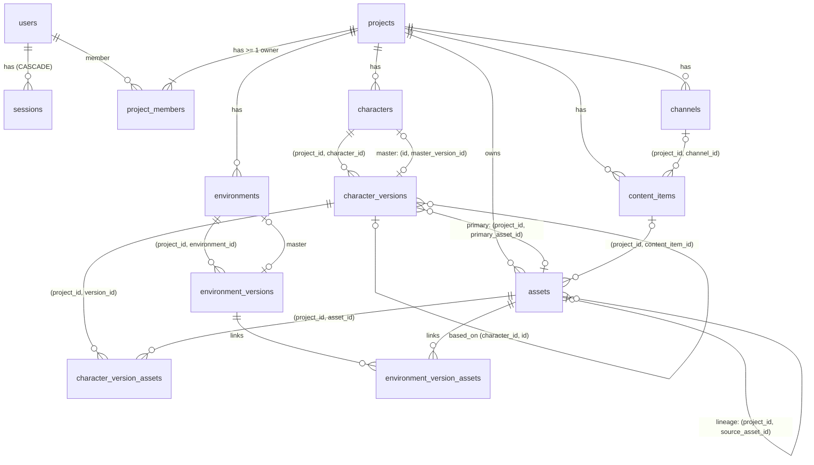

# M1 Design Review Package — Domain, Persistence, Identity & Access

- Status: **Revision 4, approved by the owner (2026-11-17).** Implemented in slices M1a–M1e (§12); M1 accepted (2026-11-17).
- Date: 2026-11-17
- Supersedes: revision 3 (`372d976`), revision 2 (`c5b9105`) and revision 1 (`M1-domain-auth-proposal.md`)
- Companion files:
  - [`m1/schema.prisma`](m1/schema.prisma): complete Prisma schema proposal, validated with
    Prisma 7.10.1
  - [`m1/triggers.sql`](m1/triggers.sql): CHECK constraints, functions and triggers
  - [`m1/generated-tables.sql`](m1/generated-tables.sql): DDL generated from the schema by Prisma
  - [`m1/evidence/`](m1/evidence/README.md): scripts and results that verified this design on
    PostgreSQL 17.12, NestJS 12.3.2 / Express 5.3.0 and Next.js 16.4.6
  - ADR-0009 (updated), ADR-0010 and ADR-0011 (new, proposed), ADR-0007 (D10 status)

## 0. Decision log

| ID    | Decision                                                    | Status                                                                                               |
| ----- | ----------------------------------------------------------- | ---------------------------------------------------------------------------------------------------- |
| D1    | Master = latest approved version; approvals are append-only | Approved                                                                                             |
| D2    | Custom Prisma-backed express-session Store                  | **Approved** (rev. 4); conditions mapped in §5.10; now evidenced with the real Prisma 7 store (§5.9) |
| D3    | Browser → Next.js (same origin) → API                       | Approved                                                                                             |
| D4    | Minimal login / project list / logout UI                    | Approved                                                                                             |
| D5    | 24 h idle / 7 d absolute session lifetime                   | Approved                                                                                             |
| D6    | Users via CLI and seed only                                 | Approved                                                                                             |
| D7    | 404 for non-members                                         | Approved                                                                                             |
| D8    | Metadata-only asset registration                            | Approved                                                                                             |
| D9    | `If-Match` optional now, designed to become mandatory       | Approved; design in §8.4                                                                             |
| D10   | `eslint-plugin-jsx-a11y-x`                                  | Not adopted; isolated evaluation in `docs/evaluations/`                                              |
| D11   | Drafts editable until approved                              | Approved                                                                                             |
| D12   | Global project slugs                                        | Approved                                                                                             |
| U1–U7 | Open questions from revision 2                              | **Approved as documented** (§11)                                                                     |

**How D1 is reconciled with requirement 5** ("updating the current master pointer and approving
must happen atomically"): the semantics stay D1, so the master is the highest-numbered approved
version. `characters.master_version_id` / `environments.master_version_id` is a **denormalized
pointer** that always equals that version. It is written only in the approval transaction. The
database rejects any commit where an approval did not move the pointer, and rejects any pointer
move that is not forward to an approved version (§6, §7).

## 0.0 Revision 4: deadlock verification (owner request after revision 3)

**Finding: revision 3's "no deadlock" claim was wrong.** A deterministic lock-boundary harness
(`evidence/sql/lock_matrix.mjs`) sequences two sessions by _observed lock waits_
(`pg_blocking_pids`), not sleeps. Run against the committed revision-3 SQL, **20 of 40 scenarios
ended in `40P01`**, through three lock cycles:

| Cycle               | Session 1 holds → wants                                                    | Session 2 holds → wants                                                                 | Scenarios                            |
| ------------------- | -------------------------------------------------------------------------- | --------------------------------------------------------------------------------------- | ------------------------------------ |
| Archive vs approval | approval: **version** (UPDATE) → asset (trigger `FOR SHARE`)               | raw archive: **asset** (UPDATE) → version (trigger `FOR SHARE` on referencing versions) | D1, D6 (RC and RR, primary and link) |
| Parent vs asset     | service approval: **parent** → asset                                       | raw sibling approval: **asset** (trigger) → parent (pointer UPDATE)                     | D7                                   |
| Owner rows          | demotion 1: **own member row** → other owner rows (`FOR UPDATE` at commit) | demotion 2: **own member row** → other owner rows                                       | O1, O2, O3, O4                       |

The revision-3 sleep-based script never hit these windows. It also only checked the final
invariant, and so counted the aborted transaction as a valid outcome.

**Fix: one global lock order, enforced inside the triggers (§6.5):**
**version → parent → asset rows (ascending id)**, and **member → project**.

A row trigger runs _after_ its own row is locked, so each guard was rewritten to lock only rows
that come **later** in that order:

- **Approval:** locks the parent, then the assets in id order, then performs a **no-op UPDATE** of
  those assets. The write "materializes the conflict" so that archival under REPEATABLE READ
  gets `40001`.
- **Archival:** touches only its own asset row; it no longer locks versions.
- **Owner check:** writes the project row; it no longer locks other members' rows.
- **Service algorithms** use the same order (§7).

**Results (revision 4), all reproduced by `run-all.sh --negative-controls`:**

- **Lock matrix:** 40/40 scenarios with the exact expected SQLSTATEs, **0 × `40P01`**, 0
  invariant violations. Every contended scenario recorded the statement that blocked; O4 is
  sequential by design.
- **Timed A1–A4:** 16/16, asserting both sessions' exit codes and SQLSTATEs.
- **C1–C6:** now end in `AC007`/`40001`/`LAST_OWNER`, never `40P01`.
- **Negative controls:**
  - rev-3 SQL deadlocks in 20/40 matrix scenarios;
  - rev-2 SQL breaks the invariant in 14;
  - removing the materializing write breaks the invariant under RR.

## 0.1 Revision 3: review findings and resolutions

| Finding (owner review of rev. 2)                                                       | Reproduced?                                                                       | Resolution                                                                                                                               | Evidence                                                                                                         |
| -------------------------------------------------------------------------------------- | --------------------------------------------------------------------------------- | ---------------------------------------------------------------------------------------------------------------------------------------- | ---------------------------------------------------------------------------------------------------------------- |
| **CRITICAL 1**: a modified session saved after logout is recreated by `set()` (upsert) | **Yes**. With the rev. 2 store, the old cookie got **200** after logout.          | Rows are created only by `createForLogin()` right after `regenerate()`. `set()`/`touch()` are UPDATE-only (§5.3, §5.3.1).                | Session suite 49/49 (R1–R8 new). The rev. 2 store fails 11 checks (negative control). SQL ordering test S1–S3.   |
| **CRITICAL 2**: approving a draft that references an archived asset                    | **Yes**. Direct SQL committed an approved version with an archived primary asset. | Approval locks and checks every primary/linked asset (`AC010`). Archive locks referencing versions first (§6.1, §6.5).                   | Direct-SQL suite 49/49 (11 new). 16 archive/approval races at RC and RR. Two negative controls fail as expected. |
| **IMPORTANT**: the spike used `pg.Pool`, not Prisma                                    | n/a                                                                               | The spike now uses the actual `PrismaSessionStore` (Prisma 7.10.1 + `@prisma/adapter-pg` 7.10.1), with **no change** to the D2 decision. | §5.9                                                                                                             |

Also found and fixed during this revision:

- An anonymous request that writes to `req.session` makes express-session issue an inert cookie.
  It is now a design rule with a test (§5.3.1).
- Environment tables gained direct-SQL coverage.
- `agentRules: false` is verified to stop Next.js generating `AGENTS.md`.
- The runtime role `acf_app` is verified unable to disable triggers, drop triggers, truncate or
  switch `session_replication_role` (U3).

All evidence reproduces with one command (§5.9, §6.3):

```bash
bash docs/design/m1/evidence/run-all.sh --negative-controls
```

## 1. Scope

In scope:

- Identity: users, login/logout, PostgreSQL sessions, Argon2id passwords, CLI provisioning.
- RBAC: owner/editor/viewer per project, enforced in services.
- Domain: projects, members, channels, characters and versions, environments and versions,
  asset metadata and lineage, content items.
- Database: initial migration, CHECKs, triggers, seed.
- API foundation: Zod validation, OpenAPI 3.1, error envelope, cursor pagination, `If-Match`.
- Web: minimal login, project list and logout through the same-origin proxy.

Out of scope: AI providers, generation, TTS, FFmpeg, workers, object-storage uploads (M4),
scripts/storyboards/scenes (M3), generation jobs and usage (M2/M5), a public sign-up endpoint.

## 2. Final ERD



All `users` FKs (`created_by_id`, `approved_by_id`, `added_by_id`) are omitted from the diagram for
readability; see §4.

**Key structural choice: composite foreign keys on `(project_id, id)`.** Every child row carries
`project_id`, and references other project-scoped rows through `(project_id, <fk>)`. PostgreSQL
therefore rejects any cross-project reference: a version linking another project's asset, lineage
crossing projects, a content item using another project's channel. No triggers are needed for this
(verified, §6.3). Nullable composite FKs use the default `MATCH SIMPLE`, so a NULL `<fk>` is simply
not checked.

## 3. Prisma schema

The complete proposal is [`m1/schema.prisma`](m1/schema.prisma). It passes `prisma validate` and
`prisma format` with Prisma 7.10.1. Highlights:

- IDs are `@default(uuid(7)) @db.Uuid`: time-ordered and generated client-side. Verified to
  produce v7 UUIDs through `@prisma/adapter-pg`. Direct-SQL inserts must supply IDs (there is no
  DB default, because PostgreSQL 17 lacks `uuidv7()`).
- `timestamptz(3)` everywhere; snake_case tables, columns and enum values via `@map`/`@@map`.
- All relations are `onDelete: Restrict, onUpdate: Restrict`, except
  `sessions.user_id → users` (`Cascade`). Prisma's default `ON UPDATE CASCADE` was deliberately
  overridden: identifiers never change, and a cascade could silently rewrite children.
- The master pointer is modelled as `masterVersion` with `fields: [id, masterVersionId]`,
  `references: [characterId, id]`. The back relation is a list (`masterOf`) because Prisma requires
  that for a composite one-to-one. At most one character can point at a version by construction.
- No partial indexes are used. They are a _preview_ feature in Prisma 7, and indexes defined
  outside Prisma fight drift detection. The "one master image per version" rule is structural
  instead: `primary_asset_id` is a column on the version, and other references go in the link
  table.
- **Not modelled in Prisma**: CHECK constraints, functions and triggers. They live in the
  migration SQL ([`m1/triggers.sql`](m1/triggers.sql)). `prisma migrate diff` from the live
  database to the schema is **empty** with them applied (verified), so Prisma neither drops nor
  re-creates them.
- **Implementation note**: relations that share `project_id` overlap scalar fields. Services
  therefore write scalar FK columns directly (Prisma "unchecked" inputs) rather than nested
  `connect`, which is ambiguous with overlapping fields.
- `ContentStatus` uses the `docs/CONTENT_PIPELINE.md` list. This conflicts with
  `docs/DATABASE.md` §4 (decision U1).

## 4. Constraints catalogue

### 4.1 Per table

| Table                                                                | PK                                 | Unique                                                              | Foreign keys (all RESTRICT/RESTRICT unless noted)                                                                                                                                                                                             | Other indexes                                                                                                                   | CHECKs                                                                                                                                                                        |
| -------------------------------------------------------------------- | ---------------------------------- | ------------------------------------------------------------------- | --------------------------------------------------------------------------------------------------------------------------------------------------------------------------------------------------------------------------------------------- | ------------------------------------------------------------------------------------------------------------------------------- | ----------------------------------------------------------------------------------------------------------------------------------------------------------------------------- |
| `users`                                                              | `id`                               | `email`                                                             | none                                                                                                                                                                                                                                          | none                                                                                                                            | email is lower(trim()) and contains `@`                                                                                                                                       |
| `sessions`                                                           | `id_hash` (bytea)                  | none                                                                | `user_id → users` **CASCADE**                                                                                                                                                                                                                 | `user_id`, `expires_at`                                                                                                         | `octet_length(id_hash)=32`; `expires_at <= absolute_expires_at`                                                                                                               |
| `projects`                                                           | `id`                               | `slug`                                                              | `created_by_id → users`                                                                                                                                                                                                                       | `created_by_id`                                                                                                                 | none                                                                                                                                                                          |
| `project_members`                                                    | `(project_id, user_id)`            | none                                                                | `project_id → projects`; `user_id`, `added_by_id → users`                                                                                                                                                                                     | `user_id`; `(project_id, role)`                                                                                                 | none                                                                                                                                                                          |
| `channels`                                                           | `id`                               | `(project_id, slug)`; `(project_id, id)`                            | `project_id`; `created_by_id`                                                                                                                                                                                                                 | `created_by_id`                                                                                                                 | none                                                                                                                                                                          |
| `characters`                                                         | `id`                               | `(project_id, slug)`; `(project_id, id)`                            | `project_id`; `created_by_id`; `(id, master_version_id) → character_versions(character_id, id)`                                                                                                                                               | `master_version_id`; `created_by_id`                                                                                            | none                                                                                                                                                                          |
| `character_versions`                                                 | `id`                               | `(character_id, version)`; `(character_id, id)`; `(project_id, id)` | `(project_id, character_id) → characters(project_id, id)`; `(project_id, primary_asset_id) → assets(project_id, id)`; `(character_id, based_on_version_id) → character_versions(character_id, id)`; `created_by_id`, `approved_by_id → users` | `primary_asset_id`; `created_by_id`; `approved_by_id`                                                                           | `version >= 1`; status/approval consistency; `based_on_version_id <> id`                                                                                                      |
| `character_version_assets`                                           | `(character_version_id, asset_id)` | none                                                                | `(project_id, character_version_id) → character_versions(project_id, id)`; `(project_id, asset_id) → assets(project_id, id)`                                                                                                                  | `asset_id` (reverse lookup: "which versions use this asset")                                                                    | none                                                                                                                                                                          |
| `environments`, `environment_versions`, `environment_version_assets` | same as the character tables       | same                                                                | same                                                                                                                                                                                                                                          | same                                                                                                                            | same                                                                                                                                                                          |
| `assets`                                                             | `id`                               | `storage_key`; `(project_id, id)`                                   | `project_id`; `(project_id, content_item_id) → content_items(project_id, id)`; `(project_id, source_asset_id) → assets(project_id, id)`; `created_by_id`                                                                                      | `(project_id, created_at DESC, id DESC)`; `(project_id, asset_type)`; `content_item_id`; **`source_asset_id`**; `created_by_id` | `size_bytes >= 0`; checksum `^[0-9a-f]{64}$`; positive dimensions; `duration_ms >= 0`; `source_asset_id <> id`; `derived ⇒ source_asset_id NOT NULL`; non-empty `storage_key` |
| `content_items`                                                      | `id`                               | `(project_id, id)`                                                  | `project_id`; `(project_id, channel_id) → channels(project_id, id)`; `created_by_id`                                                                                                                                                          | `(project_id, created_at DESC, id DESC)`; `channel_id`; `created_by_id`                                                         | `target_duration_seconds BETWEEN 1 AND 600`                                                                                                                                   |

### 4.2 Deletion and archive behaviour

| Entity                                                        | API                                                                                         | Direct SQL `DELETE`                                              | Notes                                                   |
| ------------------------------------------------------------- | ------------------------------------------------------------------------------------------- | ---------------------------------------------------------------- | ------------------------------------------------------- |
| Project, channel, character, environment, content item, asset | `POST …/archive` sets `archived_at`; lists hide archived rows unless `includeArchived=true` | **Rejected** by a trigger (`AC006`)                              | Unarchive is not in M1 (see U7)                         |
| Approved version                                              | Never                                                                                       | **Rejected** (`AC001`)                                           | Immutable forever                                       |
| Draft version                                                 | Not exposed in M1 (see U6)                                                                  | Allowed                                                          | Only if nothing references it (FK RESTRICT)             |
| Version asset link                                            | `PUT …/assets` replaces the links of a **draft**                                            | Allowed for drafts; **rejected** for approved versions (`AC002`) |                                                         |
| Project member                                                | `DELETE /projects/:id/members/:userId`                                                      | Allowed, except removing the last owner (`AC007`)                | Membership is not history-bearing                       |
| Session                                                       | Logout / revoke                                                                             | Allowed                                                          | `ON DELETE CASCADE` from users                          |
| User                                                          | Never (disable instead)                                                                     | Blocked in practice by RESTRICT FKs from authored rows           | `status = disabled` deletes all of that user's sessions |

Maintenance escape hatch: only the table owner can `ALTER TABLE … DISABLE TRIGGER` or `TRUNCATE`
(row triggers do not fire on `TRUNCATE`). Tests use `TRUNCATE … CASCADE` for cleanup. See U3 for
separating the runtime database role from the owner role.

### 4.3 Asset lineage

- `source_asset_id` is set at insert and immutable (trigger), must be in the same project
  (composite FK), and can't point at the row itself (CHECK). A new row can't be referenced
  before it exists, and the pointer can never change afterwards, so **cycles are impossible**.
- **Forward traversal** (descendants of an asset) uses the `assets_source_asset_id_idx` index:
  a recursive CTE walking `WHERE source_asset_id = $parent`.
- **Reverse traversal** (ancestors) follows primary keys: a recursive CTE on
  `id = child.source_asset_id`. Both are bounded by a depth limit (default 50) as defence against
  pathological chains.
- **Usage traversal** ("which versions reference this asset") uses
  `character_version_assets_asset_id_idx`, `environment_version_assets_asset_id_idx` and the
  `primary_asset_id` indexes.
- API: `GET /assets/:id/lineage?direction=ancestors|descendants&depth=…` (paginated for
  descendants).

## 5. Sessions: schema and express-session integration (D2)

### 5.1 Table

```text
sessions(
  id_hash             bytea PRIMARY KEY,        -- SHA-256(express-session ID), 32 bytes
  user_id             uuid NOT NULL REFERENCES users ON DELETE CASCADE,
  data                jsonb NOT NULL,           -- allow-listed: { cookie, userId, authenticatedAt }
  expires_at          timestamptz(3) NOT NULL,  -- idle expiry (rolling, capped)
  absolute_expires_at timestamptz(3) NOT NULL,  -- created_at + 7 d, never extended
  created_at, last_seen_at timestamptz(3) NOT NULL)
INDEX(user_id), INDEX(expires_at)
```

### 5.2 Responsibilities

| Concern                                                                                                                                                                                          | Owner                                                                                                                                                                                                                                                                  |
| ------------------------------------------------------------------------------------------------------------------------------------------------------------------------------------------------ | ---------------------------------------------------------------------------------------------------------------------------------------------------------------------------------------------------------------------------------------------------------------------- |
| Session ID generation (`uid-safe`, 24 random bytes / 192 bits), cookie signing and rotation-capable verification (`cookie-signature`, array of secrets), `regenerate`, `destroy`, rolling cookie | **express-session 1.19.0**, unmodified                                                                                                                                                                                                                                 |
| Hashing the ID for the lookup key                                                                                                                                                                | `node:crypto` `createHash('sha256')` (standard library; no custom crypto). An unsalted fast hash is appropriate because the input is a 192-bit random token, not a password.                                                                                           |
| Persistence (`createForLogin`, `get`, `set`, `touch`, `destroy`, `destroyAllForUser`, `pruneExpired`)                                                                                            | Our `PrismaSessionStore extends session.Store`: persistence only, **Prisma 7.10.1 + `@prisma/adapter-pg`**. Model API for create/read/delete, tagged `$executeRaw` for the two capped UPDATEs (`LEAST(…)`). Source: `m1/evidence/session/src/prisma-session-store.ts`. |
| Password hashing                                                                                                                                                                                 | `argon2` 0.45.2 (Argon2id)                                                                                                                                                                                                                                             |
| CSRF tokens (HMAC, constant-time compare)                                                                                                                                                        | `csrf-csrf` 4.1.0                                                                                                                                                                                                                                                      |

### 5.3 Store semantics

All expiry comparisons use one injected application clock (`now()` option), so `get`, `set` and
`touch` agree on what "expired" means.

| Method                      | Statement                                                                                                                                                                                                                                                                                  | Guarantees                                                                                                                                                                     |
| --------------------------- | ------------------------------------------------------------------------------------------------------------------------------------------------------------------------------------------------------------------------------------------------------------------------------------------ | ------------------------------------------------------------------------------------------------------------------------------------------------------------------------------ |
| `createForLogin(sid, sess)` | `prisma.session.create(...)`: **the only INSERT**. `absolute_expires_at = now + 7 d`; `expires_at = min(cookie.expires, absolute)`. Plain INSERT (no upsert), so a duplicate hash fails loudly.                                                                                            | Called by `AuthService.login` only, immediately after `req.session.regenerate()`, for an ID no other request has seen                                                          |
| `get(sid)`                  | `findFirst({ idHash, expiresAt > now, absoluteExpiresAt > now })`                                                                                                                                                                                                                          | Expired, revoked or unknown sessions resolve to `null`, so the request is unauthenticated                                                                                      |
| `set(sid, sess)`            | **UPDATE only**: `UPDATE sessions SET data, expires_at = LEAST(cookie.expires, absolute_expires_at), last_seen_at WHERE id_hash = … AND user_id = … AND expires_at > now AND absolute_expires_at > now`. **There is no INSERT path.** Sessions without `userId` are a no-op, not an error. | Cannot recreate a revoked or expired session. Cannot switch the row's user. Absolute expiry is never extended. Payload is allow-listed to `{cookie, userId, authenticatedAt}`. |
| `touch(sid, sess)`          | UPDATE only, same predicates, plus `last_seen_at <= now − 60 s` (throttle)                                                                                                                                                                                                                 | Same as `set`                                                                                                                                                                  |
| `destroy(sid)`              | `deleteMany({ idHash })`                                                                                                                                                                                                                                                                   | Immediate revocation (logout, `regenerate`)                                                                                                                                    |
| `destroyAllForUser(userId)` | `deleteMany({ userId })`                                                                                                                                                                                                                                                                   | Password change, disable, CLI                                                                                                                                                  |
| `pruneExpired()`            | `deleteMany({ expiresAt <= now OR absoluteExpiresAt <= now })`, hourly, `unref`'d timer                                                                                                                                                                                                    | Housekeeping only; correctness never depends on it                                                                                                                             |

### 5.3.1 Revocation safety (CRITICAL 1)

**The defect (rev. 2)**: request A loads session S and modifies it, B logs out (deletes S), then
A finishes and express-session calls `set(S)`. Rev. 2's upsert recreated S, and the old cookie
worked again. Reproduced: after logout the old cookie got `200`.

**The fix: creation is separated from update.**

- Only the login handler creates rows (`createForLogin`), right after `regenerate()` has minted a
  fresh 192-bit ID that has never been sent to any client.
- Every other write (`set`, `touch`) is an `UPDATE … WHERE id_hash = … AND <not expired>`.
- A destroyed ID therefore has no code path back into the table.

| Interleaving (same row)                           | What PostgreSQL does                                                                                            | Outcome                          |
| ------------------------------------------------- | --------------------------------------------------------------------------------------------------------------- | -------------------------------- |
| DELETE committed, then late UPDATE (`set`)        | The UPDATE matches 0 rows                                                                                       | Stays revoked (verified: S3, R1) |
| DELETE in flight, UPDATE arrives                  | The UPDATE waits on the row lock. After the DELETE commits it re-checks, finds the row gone, and affects 0 rows | Stays revoked (verified: S1)     |
| UPDATE in flight, DELETE arrives                  | The DELETE waits, then deletes the updated row                                                                  | Revoked (verified: S2)           |
| `regenerate()` or revoke-all while A is in flight | Same as the first row (the old row is deleted)                                                                  | Stays revoked (verified: R3, R4) |

Each store call is a single autocommit statement (READ COMMITTED), so set/destroy ordering is
atomic per statement. No multi-statement transaction or tombstone table is needed.

**Why not a tombstone table?** A tombstone protects an INSERT path. Here no INSERT path exists
for an existing or revoked ID: `set()` cannot insert, and `createForLogin()` only ever receives a
freshly generated ID. A tombstone would add a second table to maintain and prune, and a
check-then-insert race of its own, without closing any additional path. If a future change ever
needs to create rows elsewhere, this decision must be revisited (recorded in ADR-0009).

**Accepted residual behaviour (documented, tested):**

- A request that was authorized **before** logout may still complete (R1: A returns 200). Its
  session writes are discarded. Authorization is per request, and the next request is
  unauthenticated.
- With `rolling: true`, such a late response may re-send `Set-Cookie` with the dead ID. The
  cookie is inert: no row, so 401.
- If application code writes to an **anonymous** session, express-session issues a cookie even
  though nothing is stored (R7). The cookie is inert. **Design rule**: public handlers never
  write to `req.session`; only login does, after `regenerate()` + `createForLogin()`. An M1 test
  asserts that no public route (including a failed login) sets a session cookie.

### 5.4 Configuration

```ts
app.set('trust proxy', env.TRUST_PROXY); // e.g. "loopback" or the Next.js host/subnet
app.use(helmet());
app.use(cookieParser()); // required by csrf-csrf
app.use(
  session({
    name: env.SESSION_COOKIE_SECURE ? '__Host-acf_sid' : 'acf_sid',
    secret: env.SESSION_SECRETS, // [current, ...previous] for rotation
    store: prismaSessionStore,
    resave: false,
    saveUninitialized: false,
    rolling: true,
    unset: 'destroy',
    cookie: {
      httpOnly: true,
      sameSite: 'lax',
      secure: env.SESSION_COOKIE_SECURE,
      path: '/',
      maxAge: env.SESSION_IDLE_TTL_MS,
    }, // 24 h; no `domain`
  }),
);
app.use(originCheck(env.WEB_ORIGINS)); // all non-GET/HEAD/OPTIONS, including login
app.use(csrfProtection); // csrf-csrf; skips safe methods and POST /auth/login
```

- `__Host-` requires `Secure`, so it is used whenever `SESSION_COOKIE_SECURE=true`. That is the
  default in production; config validation **rejects** `NODE_ENV=production` with
  `SESSION_COOKIE_SECURE=false`. Local development over `http://localhost` uses `acf_sid` without
  `Secure`.
- New env vars, validated by `packages/config`: `SESSION_SECRETS` (comma list, each ≥ 32 chars),
  `CSRF_SECRET` (≥ 32 chars, distinct from the session secrets), `SESSION_COOKIE_SECURE`,
  `SESSION_IDLE_TTL_MS` (default 24 h), `SESSION_ABSOLUTE_TTL_MS` (default 7 d), `TRUST_PROXY`,
  `WEB_ORIGINS`. Secrets are never logged.
- Augmented `SessionData`: `{ userId?: string; authenticatedAt?: string }` only. No password,
  hash, email, role, IP or user agent. Roles are read from the database on every request, so
  revocation and role changes take effect immediately.

### 5.5 Flows

1. **Login** (`POST /api/v1/auth/login`, public, Origin-checked, throttled):
   1. Validate `{email, password}`.
   2. Load the user by normalized email and run `argon2.verify`. Unknown emails are verified
      against a fixed dummy hash so timing is uniform. Disabled users get the same generic
      `401 INVALID_CREDENTIALS`.
   3. `req.session.regenerate()` (fixation defence; the previous row is deleted). Set
      `userId` / `authenticatedAt`, then call `store.createForLogin(req.sessionID, req.session)`
      (the only INSERT). express-session's end-of-request save then goes through UPDATE-only
      `set()`.
   4. If `argon2.needsRehash`, re-hash and store.
   5. Respond with the profile and a fresh CSRF token (bound to the new session ID).
   6. **Fail closed**: if `cookie.secure` is on but `req.secure` is false (proxy
      misconfiguration), express-session silently skips `Set-Cookie`. This was observed in the
      spike. The handler detects it and returns `500 SESSION_COOKIE_NOT_SET` instead of a
      misleading 200.
2. **Every request**: express-session loads the session through the store. `SessionAuthGuard`
   (global; `@Public()` opts out) loads the user. If the user is missing or disabled, it destroys
   the session and returns 401. It attaches `Actor { userId }`.
3. **Logout** (`POST /auth/logout`, CSRF-protected): `session.destroy()` deletes the row, the
   cookie is cleared, and the response is 204.
4. **Password change** (CLI `pnpm user:set-password`) and **disable** (CLI `pnpm user:disable`):
   update the user, then `destroyAllForUser` in the same transaction.

### 5.6 Topology and proxy headers (verified)

```text
browser ──HTTPS──> TLS proxy ──HTTP──> Next.js (web) ──HTTP rewrite──> API (private network only)
                   sets X-Forwarded-Proto: https      passes it through   trusts only the Next hop
```

- The Next.js rewrite **forwards `Set-Cookie`** and adds `X-Forwarded-Host`. It **does not add
  `X-Forwarded-Proto`**; it passes through whatever it received. The TLS proxy must therefore
  _overwrite_ `X-Forwarded-Proto`. The API must not be publicly reachable, because it trusts
  forwarded headers from the proxy hop.
- In secure mode, with `X-Forwarded-Proto: https` the API sees `req.secure=true` and sets
  `__Host-acf_sid=…; Path=/; HttpOnly; Secure; SameSite=Lax` with no `Domain` (verified).
  Without the header, no session cookie is set, which the login fail-closed check catches.

### 5.7 CSRF and Origin

- **Origin check**: every non-safe method must carry an `Origin` in `WEB_ORIGINS`. If `Origin` is
  absent, `Sec-Fetch-Site: same-origin` is required. If both are absent, the request is rejected
  with `403 ORIGIN_REJECTED`. This also protects login, where no session exists yet.
- **Token**: `csrf-csrf` signed double-submit, bound to `req.sessionID`, sent in `x-csrf-token`.
  The cookie is `__Host-acf_csrf` in secure mode. It is issued in the login response and by
  `GET /auth/csrf`. Because it is bound to the session ID, a token is invalid after
  logout/regenerate (verified: missing → 403, forged → 403, valid → 200).

### 5.8 NestJS 12 adapter compatibility (verified)

- `@nestjs/platform-express` 12.3.2 depends on **Express 5.3.0**. express-session 1.19.0,
  cookie-parser 1.4.7 and csrf-csrf 4.1.0 are registered with `app.use()` before Nest's router,
  and work unchanged.
- The session API is callback-based; thin `promisify` wrappers are used in the auth service
  (`regenerate`, `save`, `destroy`).
- Types come from `@types/express-session` 1.19.0. The `SessionData` augmentation lives in
  `apps/api/src/auth/session.types.ts`.

### 5.9 Verification results: real `PrismaSessionStore`, 49/49 passed

Setup (reproduced by `run-all.sh`):

- **Stack:** NestJS 12.3.2 (Express 5.3.0), express-session 1.19.0, csrf-csrf 4.1.0,
  **Prisma 7.10.1 + `@prisma/adapter-pg` 7.10.1**, PostgreSQL 17.12.
- **Database:** a fresh database built from the committed `generated-tables.sql` +
  `triggers.sql`.
- **Credentials:** the API connects as the DML-only role **`acf_app`** (U3).
- **Traffic:** all requests go **through the Next.js 16.4.6 rewrite proxy**.

| Group                                     | Checks                                                                                                                                                                                                                                                                |
| ----------------------------------------- | --------------------------------------------------------------------------------------------------------------------------------------------------------------------------------------------------------------------------------------------------------------------- |
| Baseline (25, ported to the Prisma store) | Cookie attributes; hashed key; allow-listed payload; CSRF missing/valid/forged; fixation (new ID, old row deleted); logout; read-only in-flight request; 20 concurrent requests; idle and absolute expiry; rolling cap; revoke-all; garbage cookie; no anonymous rows |
| **R1**: the reviewer's scenario           | A modifies a persisted field and pauses; B logs out; A completes. The store's event log proves **`set()` ran after the destroy and matched 0 rows**. The row stays absent and the old cookie gets 401.                                                                |
| R2                                        | Same, with a non-persisted field (still triggers `set`)                                                                                                                                                                                                               |
| R3                                        | Re-login (`regenerate`) while A is in flight on the old ID: old ID absent and 401; new session created legitimately and works                                                                                                                                         |
| R4                                        | Revoke-all (password change/disable) while two modifying requests are in flight: both stay revoked                                                                                                                                                                    |
| R5                                        | 10 concurrent modifying requests with logout in the middle: no resurrection                                                                                                                                                                                           |
| R6                                        | A legitimate modification without logout still persists (`set` updated 1 row)                                                                                                                                                                                         |
| R7                                        | An anonymous session write gives 200 (no 500) and no row. A failed login sets no cookie. An inert cookie is documented (§5.3.1).                                                                                                                                      |
| R8                                        | Login after logout yields a fresh, different ID                                                                                                                                                                                                                       |

**Negative control:** the same suite against the rev. 2 `set()` (upsert) fails **11** checks
(R1–R5). The regression tests detect the defect; the old read-only test did not.

### 5.10 D2 condition traceability

| Owner condition                                                       | Where satisfied                                                       |
| --------------------------------------------------------------------- | --------------------------------------------------------------------- |
| Standard express-session Store interface                              | §5.2, §5.3 (`extends session.Store`)                                  |
| No custom session management, ID generation, cookie signing or crypto | §5.2 (express-session, `node:crypto` hash only)                       |
| Minimum session data                                                  | §5.3 `set` allow-list, §5.4 `SessionData`                             |
| Store a hash of the ID as the lookup key                              | `id_hash` PK, CHECK on 32 bytes, §5.1                                 |
| Enforce `expiresAt`, reject expired                                   | `get` predicate, §5.3; verified                                       |
| Logout revokes immediately                                            | `destroy` = DELETE; verified                                          |
| Revoke all sessions on password change / disable                      | `destroyAllForUser`, §5.5 step 4                                      |
| HttpOnly, SameSite=Lax, Secure in prod, `__Host-`, no Domain, Path=/  | §5.4; config rejects insecure production                              |
| Tests: expiration, logout, invalid sessions, fixation, concurrency    | Spike suite (§5.9) becomes `apps/api/test/auth/*.integration.test.ts` |
| Verify on the real NestJS 12 adapter and document                     | §5.8                                                                  |
| No passwords or sensitive data in payloads                            | §5.4                                                                  |
| (rev. 3) `set()` cannot recreate a revoked ID                         | §5.3 (UPDATE-only), §5.3.1; R1–R5, S1–S3                              |
| (rev. 3) Legitimate creation after login/regenerate preserved         | `createForLogin`, §5.5; R3, R6, R8                                    |
| (rev. 3) set/destroy ordering atomic under concurrency                | §5.3.1 interleaving table; S1–S3                                      |
| (rev. 3) A modifies + pauses, B logs out, A completes; old cookie 401 | R1 (exact scenario), with store event proof                           |
| (rev. 3) Actual Prisma-backed store evidenced                         | §5.9 (Prisma 7.10.1 + adapter-pg)                                     |

## 6. PostgreSQL triggers and migration strategy

### 6.1 Trigger inventory ([`m1/triggers.sql`](m1/triggers.sql))

| Trigger                       | Table / timing                                                                     | Rule                                                                                                                                                                                                                                                                                                                                    | SQLSTATE                      |
| ----------------------------- | ---------------------------------------------------------------------------------- | --------------------------------------------------------------------------------------------------------------------------------------------------------------------------------------------------------------------------------------------------------------------------------------------------------------------------------------- | ----------------------------- |
| `*_no_delete`                 | projects, channels, characters, environments, assets, content_items; BEFORE DELETE | Archive only                                                                                                                                                                                                                                                                                                                            | `AC006`                       |
| `*_versions_guard`            | character/environment versions; BEFORE INSERT/UPDATE/DELETE                        | Insert only as `draft`; approved rows are frozen (no UPDATE or DELETE); identity columns of drafts are frozen. **On `draft → approved`: locks the parent, then the primary and every linked asset `FOR NO KEY UPDATE` in id order, writes them with a no-op UPDATE (materialized conflict), and rejects any archived asset** (rev. 3/4) | `AC009`, `AC001`, **`AC010`** |
| `*_version_assets_guard`      | link tables; BEFORE INSERT/UPDATE/DELETE                                           | No link changes for approved versions. Reads the parent `FOR SHARE`, so it **waits for an in-flight approval** and then sees its result. Link keys are immutable.                                                                                                                                                                       | `AC002`                       |
| `*_master_guard`              | characters/environments; BEFORE INSERT/UPDATE                                      | The pointer starts NULL. It may only move **forward** (higher version number) to an **approved** version and can never be cleared. Same-parent is enforced by the composite FK.                                                                                                                                                         | `AC003`                       |
| `*_approval_sets_master`      | versions; **deferred constraint trigger**, AFTER UPDATE OF status                  | At COMMIT, a version approved in the transaction must be the parent's master                                                                                                                                                                                                                                                            | `AC004`                       |
| `assets_guard`                | assets; BEFORE UPDATE                                                              | File identity and provenance columns are immutable. On archive (`archived_at` NULL → set): refuses if any referencing version is approved. **Locks nothing but its own row** (rev. 4: the rev-3 version locks formed the asset→version half of a deadlock cycle).                                                                       | `AC005`, `AC008`              |
| `project_members_keep_owner`  | project_members; deferred, AFTER UPDATE/DELETE of an owner row                     | At COMMIT the project still has ≥ 1 owner. **Writes the project row** (no-op UPDATE), then counts owners. No other member rows are locked (rev. 4).                                                                                                                                                                                     | `AC007`                       |
| `projects_created_with_owner` | projects; deferred, AFTER INSERT                                                   | A project must be created together with its owner membership                                                                                                                                                                                                                                                                            | `AC007`                       |

### 6.2 Behaviour under direct SQL (verified, 49/49)

Every rule above fires for raw `UPDATE`/`DELETE`/`INSERT` issued outside the application, as
does the composite-FK project isolation. The test script
[`evidence/sql/test_direct_sql.sql`](m1/evidence/README.md) asserts the exact SQLSTATE for each
case, for example:

- Editing an approved version: `AC001`.
- Reverting it to draft: `AC001`.
- Deleting it: `AC001`.
- Adding, removing or reordering its links: `AC002`.
- Moving the master backwards or to a draft: `AC003`.
- Approving without moving the master: `AC004` at COMMIT.
- Changing `storage_key`/`checksum`/`size`/`mime`: `AC005`.
- Re-parenting lineage: `AC005`.
- Cross-project link or lineage: `23503`.
- Demoting or deleting the last owner: `AC007`.
- Hard deletes: `AC006`.
- (rev. 3) Approving a draft whose **primary** asset is archived: `AC010`.
- (rev. 3) Approving a draft with a **linked** archived asset: `AC010`. The same for
  environments.
- (rev. 3) Approve, then archive its asset in the same transaction: `AC008`.
- (rev. 3) Archiving an asset used only by drafts is allowed (U4). Unarchive-then-approve
  succeeds (control).
- (rev. 3) Environment tables: immutability `AC001`, frozen links `AC002`, in-use archive
  `AC008`, delete `AC006`.

### 6.3 Concurrency (verified with two concurrent sessions)

| Case                                                                              | Result                                                                                                                                                                                                                                                       |
| --------------------------------------------------------------------------------- | ------------------------------------------------------------------------------------------------------------------------------------------------------------------------------------------------------------------------------------------------------------ |
| C1: two owners demote each other concurrently (READ COMMITTED, raw SQL)           | One commits; the other fails with `AC007` (rev. 4; in rev. 3 this could deadlock, `40P01`). **The project always keeps an owner.**                                                                                                                           |
| C2: link insert while an approval of that version is in flight                    | The insert waits on the `FOR SHARE` lock, then fails with `AC002`; 0 links added                                                                                                                                                                             |
| C3: approvals of v5 and v4 race without the service lock                          | v5 wins; v4's pointer move fails with `AC003`, and v4 stays draft                                                                                                                                                                                            |
| C4: the same version approved twice with the service algorithm                    | The second caller blocks on the version lock, then sees `approved` and does nothing                                                                                                                                                                          |
| C5: C1 under **REPEATABLE READ**                                                  | **Initially left zero owners.** The trigger only locked the project row, which a stale RR snapshot does not protect. **Fixed (rev. 4 form)**: the trigger writes the project row, so a concurrent change at RR raises `40001`. Re-verified, with no `40P01`. |
| C6: service last-owner algorithm (rev. 4 order: member → project → count)         | READ COMMITTED: first commits, second gets a clean `409 LAST_OWNER`. REPEATABLE READ: second gets `40001`. SQLSTATEs asserted.                                                                                                                               |
| **A1** (timed): raw archive first, then approval (primary and link)               | First commits. Second: RC `AC010`, RR `40001`. Asserted per session (exit code and SQLSTATE).                                                                                                                                                                |
| **A2** (timed): raw approval first, then archive                                  | First commits. Second: RC `AC008`, RR `40001`.                                                                                                                                                                                                               |
| **A3** (timed): service approval first, then service archive                      | First commits. Second: RC decision `409 ASSET_IN_USE`, RR `40001`.                                                                                                                                                                                           |
| **A4** (timed): service archive first, then service approval                      | First commits. Second: RC decision `409 ASSET_ARCHIVED`, RR `40001`.                                                                                                                                                                                         |
| Negative control: approval only _locks_ assets (no materializing write), A2 at RR | **Invariant violated** (`second=commit`, `invariant=BROKEN(1)`). This proves the no-op write is required for REPEATABLE READ.                                                                                                                                |
| U3: `acf_app` tries to bypass the triggers                                        | `ALTER TABLE … DISABLE TRIGGER`, `TRUNCATE`, `DROP TRIGGER`, `SET session_replication_role` are all denied                                                                                                                                                   |

A1–A4 ran for primary and linked references at both isolation levels (16 runs). Revision 3 said
"no deadlocks occurred, because each side acquires both of its locks within its first statement".
**That reasoning was wrong.** Within one statement the row lock and the trigger's locks are
separate acquisitions, and opposite orders across sessions can still form a cycle. The
deterministic matrix (§6.3.1) found exactly that.

#### 6.3.1 Deterministic lock-boundary matrix (`evidence/sql/lock_matrix.mjs`)

**How it works:**

- Two sessions connect as `acf_app` and are driven step by step.
- Before the next step, each step waits until its statement has either **completed** or is
  **observed blocked** (`pg_blocking_pids(pid) <> '{}'`), so every run reproduces the same
  interleaving at the same lock boundary.
- The harness records every statement's outcome and SQLSTATE, and asserts the exact final outcome
  of both sessions.
- A scenario **fails** on:
  - any `40P01`;
  - any invariant violation (approved version referencing an archived asset; project without an
    owner; master pointer not equal to the highest approved version);
  - a schedule that never actually blocked (overlap not exercised; only O4 is exempt, being
    sequential by design).
- Each scenario runs for primary and linked references (link mode links **two** assets, to
  exercise multi-row ordering) under READ COMMITTED and REPEATABLE READ.

| Scenario | Lock boundary exercised                                                                            | Observed blocked    | RC result (A / B)             | RR result (A / B) |
| -------- | -------------------------------------------------------------------------------------------------- | ------------------- | ----------------------------- | ----------------- |
| D1       | approval holds **version**; raw archive takes **asset**; approval then needs the asset             | A: approve          | `AC010` / commit              | `40001` / commit  |
| D2       | raw archive holds the asset; raw approval arrives                                                  | A: approve          | `AC010` / commit              | `40001` / commit  |
| D3       | raw approval holds the assets; raw archive arrives                                                 | B: archive          | commit / `AC008`              | commit / `40001`  |
| D4       | raw archive holds the asset; service approval locks version → parent → assets                      | A: svc lock assets  | `ASSET_ARCHIVED` / commit     | `40001` / commit  |
| D5       | service approval holds the assets; raw archive arrives                                             | B: archive          | commit / `AC008`              | commit / `40001`  |
| D6       | service archive holds the asset (checked unused); service approval arrives                         | A: svc lock assets  | `ASSET_ARCHIVED` / commit     | `40001` / commit  |
| D7       | service approval of v1 holds version + **parent**; raw approval of v2 (same parent, shared assets) | B: approve v2       | commit / commit (master = v2) | commit / `40001`  |
| D8       | two raw approvals on different parents sharing assets (multi-row ordering)                         | B: approve          | commit / commit               | commit / `40001`  |
| O1       | two raw demotions; both deferred owner checks fired while both are open                            | B: owner check      | commit / `AC007`              | commit / `40001`  |
| O2       | service demotion (member → project → count) vs raw demotion                                        | B: COMMIT           | commit / `AC007`              | commit / `40001`  |
| O3       | two service demotions overlapping                                                                  | B: svc lock project | commit / `LAST_OWNER`         | commit / `40001`  |
| O4       | two raw demotions, plain COMMITs (sequential by design)                                            | (none)              | commit / `AC007`              | commit / `40001`  |

Totals: **revision 4: 40 runs, 40 pass, 0 × `40P01`, 0 invariant violations.**

The same harness and schedules against the old SQL:

- **Revision 3:** `40P01` in D1, D6, D7, O1, O2, O3, O4, i.e. **20/40 runs** (both isolation
  levels; D-scenarios for both reference kinds).
- **Revision 2:** **14** invariant violations (archived assets in approved versions).

Results are identical for primary and linked references.

Rule: **application transactions run at READ COMMITTED** (the PostgreSQL and Prisma default) and
take explicit row locks in protocol order (§6.5, §7). The triggers stay correct at any isolation
level: a race ends with `AC0xx` or `40001`, never a broken invariant, and never `40P01` on
protocol-following paths. The API maps `40001` to `409 CONCURRENT_MODIFICATION`
(`retryable: true`) after one internal retry. A `40P01` is treated as a **defect** (logged at
error level and alerted), not a normal outcome. It is still mapped to the same retryable 409, so
a client never sees a 500 if a future bug introduces a cycle.

### 6.4 Migration strategy

1. Copy `m1/schema.prisma` into `packages/database/prisma/schema.prisma`.
2. `prisma migrate dev --create-only --name init_m1` creates the table DDL.
3. Append `triggers.sql` to that `migration.sql`, unchanged, as one migration.
4. `prisma migrate dev` applies it.
5. Commit the migration.
6. Never edit an applied migration. Later migrations that alter guarded tables must keep the
   triggers. If a column list in a frozen-key array changes, the function is replaced with
   `CREATE OR REPLACE FUNCTION` in the new migration.
7. **Guard against silent loss**: an integration test queries `pg_trigger`/`pg_constraint` and
   asserts that every expected trigger and CHECK exists and is enabled.
8. **Drift**: verified that `prisma migrate diff --from-config-datasource --to-schema` is empty
   with the triggers applied. CI runs this check after migrating the test database.
9. Tests: the integration DB `acf_test` is created by the test setup, then
   `prisma migrate deploy`. Each test file cleans up with
   `TRUNCATE … RESTART IDENTITY CASCADE`, which bypasses row triggers by design.

### 6.5 Locking protocol and guarantees (revision 4)

**Global lock order:**

```text
  link row ─▶ version ─▶ parent (character / environment) ─▶ asset rows (ascending id)
  member row ─▶ project
```

Every operation acquires its exclusive or share row locks in this order, whether it runs through
the service or as raw SQL via the triggers. A row trigger fires _after_ its own row is locked, so
a guard may only lock rows that come **later** than the row being written. Revision 3 broke this
in two places: archive locked versions, and the owner check locked other member rows.

| Operation                          | Locks acquired, in order                                                                                                                                                         | Waits for                                                                                                         |
| ---------------------------------- | -------------------------------------------------------------------------------------------------------------------------------------------------------------------------------- | ----------------------------------------------------------------------------------------------------------------- |
| Approve (raw `UPDATE versions`)    | version (row lock of the UPDATE) → parent `FOR NO KEY UPDATE` (trigger) → assets `FOR NO KEY UPDATE`, id order, + no-op UPDATE (trigger) → parent (pointer UPDATE, already held) | archive of those assets; other approvals of the same parent or sharing an asset; link edits are blocked behind it |
| Approve (service)                  | version `FOR UPDATE` → parent `FOR NO KEY UPDATE` → assets `FOR NO KEY UPDATE`, id order → (UPDATE version, UPDATE parent: already held)                                         | same                                                                                                              |
| Archive (raw or service)           | asset row only (`FOR NO KEY UPDATE` / its UPDATE)                                                                                                                                | an approval holding that asset                                                                                    |
| Link add/remove/reorder (draft)    | link row (for update/delete) → version `FOR SHARE` (trigger). FK checks take `KEY SHARE` on the version/asset, which does not conflict with `NO KEY UPDATE`.                     | an approval of that version                                                                                       |
| Draft edit                         | version row                                                                                                                                                                      | an approval of that version                                                                                       |
| Version creation (service)         | parent `FOR NO KEY UPDATE` (new version row: nobody can wait on it)                                                                                                              | approvals of that parent                                                                                          |
| Master pointer move                | parent row                                                                                                                                                                       | approvals of that parent                                                                                          |
| Owner change (raw or service)      | own member row → project row (no-op UPDATE; service immediately, trigger again at commit)                                                                                        | other owner changes of the same project                                                                           |
| Session `set`/`touch` vs `destroy` | session row (single statement)                                                                                                                                                   | each other (§5.3.1)                                                                                               |

**Why no cycle can form:**

- Every multi-lock operation acquires locks in increasing protocol order, and assets are always
  taken in ascending id.
- A transaction holding a "later" row never waits for an "earlier" one: archive holds only an
  asset, a pointer move holds only a parent, and the owner check holds member → project.
- Therefore the wait-for graph is acyclic.
- This is verified for every boundary listed in §6.3.1, including the three cycles found in
  revision 3.

**Why REPEATABLE READ is still safe ("materialized conflicts"):** a guard that reads rows to
decide (archive: "is the asset used by an approved version?"; owner check: "is an owner left?")
cannot lock earlier rows without recreating a cycle. Instead, the competing operation **writes
the shared row that comes later in the order**:

- approval writes the asset rows;
- every owner change writes the project row.

A REPEATABLE READ transaction that then updates or locks that row gets `40001`, because the row
was changed by a concurrent transaction. It never acts on a stale snapshot. The negative control
shows that without the write, the invariant breaks under RR.

**Guarantees:**

1. Invariants hold for **any** client: the service, raw SQL, or a future worker.
2. **No deadlock (`40P01`) on any path that follows the protocol**: raw single statements and the
   service algorithms. Verified: 0 in 40 deterministic runs, 0 in 16 timed runs, 0 in C1–C6.
3. **READ COMMITTED** (the application): the loser waits, re-reads the committed row, and fails
   with a precise `AC0xx`. The service pre-checks return the corresponding 409 first.
4. **REPEATABLE READ / SERIALIZABLE**: the loser fails with `40001` (retryable).
5. Races end in an error, never an invalid commit.

**Cost of the protocol (accepted):**

- Approvals that share an asset now **serialize** on that asset row (revision 3's `FOR SHARE`
  allowed them in parallel). Under READ COMMITTED both succeed in turn (D7, D8); under RR the
  second gets a retryable `40001`.
- Each approval writes one dead tuple per referenced asset, and each owner change writes one per
  project. This is negligible at MVP volume, and autovacuum reclaims it.
- Raw SQL written _outside_ the protocol (e.g. a hand-written multi-statement transaction that
  archives an asset and _then_ approves an unrelated version referencing a different locked
  asset) can still deadlock. PostgreSQL then aborts one transaction; the invariants still hold,
  and the abort is visible as `40P01`. The protocol is documented for operators in ADR-0011.

## 7. Approval and master-pointer concurrency strategy

**Approve** `POST /character-versions/:id/approve` (editor+; optional `If-Match`). The lock
order is **version → parent → assets**, the same order the trigger uses for raw SQL (§6.5):

```sql
BEGIN;                                                    -- READ COMMITTED
SELECT character_id, version, status, updated_at FROM character_versions
  WHERE id = $version FOR UPDATE;                         -- 1. lock the version
SELECT project_id, master_version_id FROM characters
  WHERE id = $character FOR NO KEY UPDATE;                -- 2. lock the parent (serializes per character)
-- authorization: ProjectAccess.require(actor, project_id, 'editor')
SELECT id, archived_at FROM assets                        -- 3. lock referenced assets, ascending id
  WHERE id IN (<primary_asset_id>, <linked asset ids>) ORDER BY id FOR NO KEY UPDATE;
-- status = 'approved'           -> 409 ALREADY_APPROVED (no change, U5)
-- If-Match given and mismatch   -> 412 PRECONDITION_FAILED
-- version <= master.version     -> 409 STALE_DRAFT (U2)
-- any locked asset archived     -> 409 ASSET_ARCHIVED (U4)
UPDATE character_versions SET status='approved', approved_at=now(), approved_by_id=$actor
  WHERE id = $version AND status = 'draft';               -- trigger: parent/asset locks already held; no-op asset write
UPDATE characters SET master_version_id = $version WHERE id = $character;
COMMIT;   -- deferred trigger confirms the pointer moved (AC004 otherwise)
```

**Archive** `POST /assets/:id/archive` (editor+) locks only the asset:

```sql
BEGIN;
SELECT id, archived_at FROM assets WHERE id = $asset FOR NO KEY UPDATE;  -- waits for an approval holding it
SELECT EXISTS (… approved version references $asset …);                  -- fresh read (RC) -> 409 ASSET_IN_USE
UPDATE assets SET archived_at = now() WHERE id = $asset;                  -- trigger re-checks (AC008)
COMMIT;
```

**Version creation**: parent `FOR NO KEY UPDATE`, then `max(version) + 1`. It is serialized
with approvals of that parent, so no retry loop is needed; `UNIQUE(character_id, version)` is
the backstop.

**Draft edit vs approval**: the edit's `UPDATE` waits for the version lock. If the approval
committed first, the trigger sees `approved` and raises `AC001`, which maps to
`409 VERSION_IMMUTABLE`. `If-Match` on approve guarantees a reviewer approves exactly what they
reviewed.

**Link edit vs approval**: the link trigger's `FOR SHARE` on the version waits for the approval
(C2).

**Prisma**: an interactive `$transaction` with `$queryRaw` for the locking reads, issued in
exactly the order above.

**Last owner** (`PATCH`/`DELETE /projects/:id/members/:userId`, owner). The lock order is
**member → project**, the same as the commit-time trigger:

```sql
BEGIN;
UPDATE project_members SET role = $role WHERE project_id = $p AND user_id = $u;  -- (or DELETE)
UPDATE projects SET updated_at = updated_at WHERE id = $p;                        -- serialize owner changes
SELECT count(*) FROM project_members WHERE project_id = $p AND role = 'owner';    -- 0 -> ROLLBACK, 409 LAST_OWNER
COMMIT;                                                                           -- deferred trigger re-checks (AC007)
```

Revision 3 locked the project _before_ touching the member row, which is the opposite of the
trigger's order. Verified in O2/O3 and C6.

## 8. API surface and permission matrix

### 8.1 Rules

Unauthenticated callers get 401. Authenticated non-members of the target project get **404**
(D7). Members whose role is too low get **403**. Checks happen **inside service methods** via
`ProjectAccess.require(actor, projectId, minRole)`. For child-ID routes, the service first loads
the row to derive `project_id`. Controllers only parse input and call services.

### 8.2 Endpoints (base `/api/v1`)

| Endpoint                                      | Unauth | Non-member | Viewer | Editor | Owner | Notes                                                                                   |
| --------------------------------------------- | :----: | :--------: | :----: | :----: | :---: | --------------------------------------------------------------------------------------- |
| `POST /auth/login`                            |   ✓    |    n/a     |  n/a   |  n/a   |  n/a  | Origin check, throttled; public                                                         |
| `POST /auth/logout`                           |  401   |     ✓      |   ✓    |   ✓    |   ✓   | CSRF                                                                                    |
| `GET /auth/me`                                |  401   |     ✓      |   ✓    |   ✓    |   ✓   | Profile plus memberships                                                                |
| `GET /auth/csrf`                              |  401   |     ✓      |   ✓    |   ✓    |   ✓   |                                                                                         |
| `POST /projects`                              |  401   |     ✓      |   ✓    |   ✓    |   ✓   | Any active user; the creator becomes owner (same transaction)                           |
| `GET /projects`                               |  401   |  own only  |   ✓    |   ✓    |   ✓   | Lists the caller's memberships only                                                     |
| `GET /projects/:projectId`                    |  401   |    404     |   ✓    |   ✓    |   ✓   |                                                                                         |
| `PATCH /projects/:projectId`                  |  401   |    404     |  403   |  403   |   ✓   | `If-Match`                                                                              |
| `POST /projects/:projectId/archive`           |  401   |    404     |  403   |  403   |   ✓   |                                                                                         |
| `GET /projects/:projectId/members`            |  401   |    404     |   ✓    |   ✓    |   ✓   |                                                                                         |
| `POST /projects/:projectId/members`           |  401   |    404     |  403   |  403   |   ✓   | Adds an existing user by email; unknown email → 404 `USER_NOT_FOUND`                    |
| `PATCH /projects/:projectId/members/:userId`  |  401   |    404     |  403   |  403   |   ✓   | Last-owner rule                                                                         |
| `DELETE /projects/:projectId/members/:userId` |  401   |    404     |  403   |  403   |   ✓   | Last-owner rule                                                                         |
| `POST /projects/:projectId/channels`          |  401   |    404     |  403   |   ✓    |   ✓   |                                                                                         |
| `GET /projects/:projectId/channels`           |  401   |    404     |   ✓    |   ✓    |   ✓   | Paginated                                                                               |
| `GET /channels/:channelId`                    |  401   |    404     |   ✓    |   ✓    |   ✓   |                                                                                         |
| `PATCH /channels/:channelId`                  |  401   |    404     |  403   |   ✓    |   ✓   | `If-Match`                                                                              |
| `POST /channels/:channelId/archive`           |  401   |    404     |  403   |   ✓    |   ✓   |                                                                                         |
| `POST /projects/:projectId/characters`        |  401   |    404     |  403   |   ✓    |   ✓   |                                                                                         |
| `GET /projects/:projectId/characters`         |  401   |    404     |   ✓    |   ✓    |   ✓   | Includes the master version summary                                                     |
| `GET /characters/:characterId`                |  401   |    404     |   ✓    |   ✓    |   ✓   |                                                                                         |
| `PATCH /characters/:characterId`              |  401   |    404     |  403   |   ✓    |   ✓   | Name/slug/description only; never the master                                            |
| `POST /characters/:characterId/archive`       |  401   |    404     |  403   |   ✓    |   ✓   |                                                                                         |
| `POST /characters/:characterId/versions`      |  401   |    404     |  403   |   ✓    |   ✓   | New draft; optional `basedOnVersionId` copies content and links                         |
| `GET /characters/:characterId/versions`       |  401   |    404     |   ✓    |   ✓    |   ✓   | Paginated, newest first                                                                 |
| `GET /character-versions/:versionId`          |  401   |    404     |   ✓    |   ✓    |   ✓   | Includes links                                                                          |
| `PATCH /character-versions/:versionId`        |  401   |    404     |  403   |   ✓    |   ✓   | Drafts only (409 `VERSION_IMMUTABLE`); `If-Match`                                       |
| `PUT /character-versions/:versionId/assets`   |  401   |    404     |  403   |   ✓    |   ✓   | Drafts only; replaces the link set; same-project assets only                            |
| `POST /character-versions/:versionId/approve` |  401   |    404     |  403   |   ✓    |   ✓   | §7; `If-Match`                                                                          |
| Environment endpoints (same nine shapes)      |  same  |    same    |  same  |  same  | same  | `/projects/:projectId/environments`, `/environments/:id…`, `/environment-versions/:id…` |
| `POST /projects/:projectId/assets`            |  401   |    404     |  403   |   ✓    |   ✓   | Metadata registration (D8); `storage_key` must start with `projects/<projectId>/`       |
| `GET /projects/:projectId/assets`             |  401   |    404     |   ✓    |   ✓    |   ✓   | Filters: `assetType`, `contentItemId`, `includeArchived`                                |
| `GET /assets/:assetId`                        |  401   |    404     |   ✓    |   ✓    |   ✓   |                                                                                         |
| `GET /assets/:assetId/lineage`                |  401   |    404     |   ✓    |   ✓    |   ✓   | §4.3                                                                                    |
| `GET /assets/:assetId/usages`                 |  401   |    404     |   ✓    |   ✓    |   ✓   | Versions referencing the asset                                                          |
| `PATCH /assets/:assetId`                      |  401   |    404     |  403   |   ✓    |   ✓   | `label`, `metadata` only; `If-Match`                                                    |
| `POST /assets/:assetId/archive`               |  401   |    404     |  403   |   ✓    |   ✓   | 409 `ASSET_IN_USE` if an approved version references it                                 |
| `POST /projects/:projectId/content`           |  401   |    404     |  403   |   ✓    |   ✓   | `status` is not client-writable (always `draft` in M1)                                  |
| `GET /projects/:projectId/content`            |  401   |    404     |   ✓    |   ✓    |   ✓   | Filters: `channelId`, `status`, `includeArchived`                                       |
| `GET /content/:contentId`                     |  401   |    404     |   ✓    |   ✓    |   ✓   |                                                                                         |
| `PATCH /content/:contentId`                   |  401   |    404     |  403   |   ✓    |   ✓   | `If-Match`                                                                              |
| `POST /content/:contentId/archive`            |  401   |    404     |  403   |   ✓    |   ✓   |                                                                                         |
| `GET /openapi.json`                           |   ✓    |     ✓      |   ✓    |   ✓    |   ✓   | Public in development; behind auth in production (env flag)                             |
| `GET /health`, `GET /health/ready`            |   ✓    |     ✓      |   ✓    |   ✓    |   ✓   | Unchanged from M0                                                                       |

Archived parents: mutations under an archived project, character or environment return
`409 ARCHIVED`. Reads still work.

**Test obligation**: a table-driven integration test runs every row above for every column
(unauthenticated, non-member, viewer, editor, owner) and asserts the status code. The table is
the single source; a test also asserts that every route registered in Nest appears in it.

### 8.3 Errors

The envelope is unchanged (API_SPEC §10). Validation failures add
`error.details: [{ path, message }]`.

| Source                             | API response                                                                                                            |
| ---------------------------------- | ----------------------------------------------------------------------------------------------------------------------- |
| Zod validation                     | 400 `VALIDATION_FAILED`                                                                                                 |
| Prisma `P2002`, by constraint name | 409, e.g. `SLUG_TAKEN`, `EMAIL_TAKEN`, `STORAGE_KEY_TAKEN`                                                              |
| Prisma `P2003` (composite FK)      | 422 `CROSS_PROJECT_REFERENCE` or `REFERENCE_NOT_FOUND`                                                                  |
| `AC001`                            | 409 `VERSION_IMMUTABLE`                                                                                                 |
| `AC002`                            | 409 `VERSION_LINKS_FROZEN`                                                                                              |
| `AC003` / `AC004`                  | 409 `MASTER_CONFLICT`                                                                                                   |
| `AC005`                            | 409 `ASSET_IDENTITY_IMMUTABLE`                                                                                          |
| `AC006`                            | 409 `ARCHIVE_ONLY`                                                                                                      |
| `AC007`                            | 409 `LAST_OWNER`                                                                                                        |
| `AC008`                            | 409 `ASSET_IN_USE`                                                                                                      |
| `AC010` (rev. 3)                   | 409 `ASSET_ARCHIVED`                                                                                                    |
| `40001`                            | 409 `CONCURRENT_MODIFICATION`, `retryable: true`, after one internal retry                                              |
| `40P01`                            | 409 `CONCURRENT_MODIFICATION`, `retryable: true`; never retried: logged as a defect and propagated immediately (§6.3.1) |

Model-operation errors arrive as `PrismaClientKnownRequestError` with
`meta.driverAdapterError.cause.originalCode` set to the SQLSTATE. **Deferred-trigger errors raised
at COMMIT arrive as a bare `DriverAdapterError`.** The mapper handles both shapes (verified in
`m1/evidence/sql/errtest.ts`). Services pre-check every rule, so trigger errors are a backstop and
normally never reach users.

### 8.4 Optimistic concurrency (D9)

- Every mutable resource response carries `ETag: W/"<updatedAt epoch-ms>"` plus `updatedAt` in
  the body.
- `PATCH`, `PUT …/assets` and `POST …/approve` accept `If-Match`. A mismatch returns
  `412 PRECONDITION_FAILED`.
- **Mandatory-ready**: a config flag `REQUIRE_IF_MATCH` (default `false`) switches a missing
  header to `428 PRECONDITION_REQUIRED`. The web client sends `If-Match` from day one, so the
  switch needs no client change.
- The comparison is a conditional `UPDATE … WHERE id = $1 AND updated_at = $2` (0 rows → 412), so
  it is race-free.

### 8.5 Other conventions

- **Pagination**: `?limit` (default 20, max 100) and `?cursor`. The cursor is opaque base64url of
  `{createdAt, id}` and backed by the `(project_id, created_at DESC, id DESC)` indexes. Response:
  `{ data, page: { nextCursor, limit } }`. Invalid cursors return 400.
- **OpenAPI 3.1** from the shared Zod schemas via `zod-openapi` 6.0.2 (`nestjs-zod` declares only
  NestJS ≤ 11). A coverage test asserts that every route is documented.
- Unknown request keys are rejected (`z.strictObject`).

## 9. Web (D4)

- `next.config.ts`: rewrite `/api/v1/:path*` to `API_INTERNAL_URL`, plus `agentRules: false`. The
  spike showed this option stops Next from generating the `AGENTS.md` that leaked into M0's
  commit.
- Pages:
  - `/login`: a client form that posts to the same-origin `/api/v1/auth/login` and stores the
    returned CSRF token in memory.
  - `/projects`: a server component that forwards the incoming `cookie` header to
    `GET /projects`. Loading, empty and error states.
  - Logout button: a POST with the CSRF token, then redirect to `/login`.
- Unauthenticated access to `/projects` redirects to `/login` (server-side check).
- Playwright E2E covers login → project list → logout against the real API and the test DB.

## 10. ADR changes in this package

- **ADR-0009** (updated, rev. 3): D2 conditions, UPDATE-only `set()` / `createForLogin`, why no
  tombstone, Prisma 7 evidence.
- **ADR-0010** (proposed, rev. 4): the approval-time asset check and the revised lock order
  (version → parent → asset).
- **ADR-0011** (proposed, rev. 4): `AC010`, the global lock protocol, materialized conflicts
  for RR-safety (replacing rev. 3's backward read locks), "40P01 is a defect", and U3
  (approved).
- **ADR-0007**: D10 recorded as "not adopted; evaluation only".

## 11. Remaining risks and open decisions

### Decisions U1–U7 (approved by the owner as documented)

| #   | Question                                                                                                             | Recommendation                                                                                                                                                                                                                                                                                                                                  |
| --- | -------------------------------------------------------------------------------------------------------------------- | ----------------------------------------------------------------------------------------------------------------------------------------------------------------------------------------------------------------------------------------------------------------------------------------------------------------------------------------------- |
| U1  | `ContentStatus` values differ between `DATABASE.md` §4 and `CONTENT_PIPELINE.md` §1.                                 | Adopt the **CONTENT_PIPELINE** list (as in the schema proposal) and update `DATABASE.md`. Only `draft` is used in M1.                                                                                                                                                                                                                           |
| U2  | Approving a draft numbered **below** the current master.                                                             | Reject with `409 STALE_DRAFT`; the user creates a new draft `basedOnVersionId` it. This keeps the master monotonic, as the trigger enforces.                                                                                                                                                                                                    |
| U3  | Database roles: should the API connect as a non-owner role (DML only), so it cannot `DISABLE TRIGGER` or `TRUNCATE`? | **Yes**: `acf_migrator` (owner; used by migrations, tests and seed) and `acf_app` (runtime DML grants), from M1 in compose and CI. Without it, the "direct SQL" protections can be switched off by the app's own credentials. **Rev. 3: verified** that `acf_app` cannot disable or drop triggers, truncate, or set `session_replication_role`. |
| U4  | Draft versions referencing an asset that is later archived.                                                          | Allowed while draft; **approval is refused** with `409 ASSET_ARCHIVED`.                                                                                                                                                                                                                                                                         |
| U5  | Second approval of an already-approved version.                                                                      | `409 ALREADY_APPROVED` with the current state in the body (not a silent 200).                                                                                                                                                                                                                                                                   |
| U6  | Discarding drafts.                                                                                                   | No delete endpoint in M1; drafts stay until approved or superseded. Add `DELETE` (drafts only) later if needed.                                                                                                                                                                                                                                 |
| U7  | Unarchive.                                                                                                           | Not in M1; owner-only `POST …/unarchive` in a later milestone.                                                                                                                                                                                                                                                                                  |

No open decisions remain in this revision.

### Risks

| Risk                                                                                                 | Mitigation                                                                                                                                        |
| ---------------------------------------------------------------------------------------------------- | ------------------------------------------------------------------------------------------------------------------------------------------------- |
| The session store is our code (persistence only)                                                     | Contract tests against express-session semantics (§5.9 suite); no crypto in it                                                                    |
| An in-flight request authorized before logout completes after it                                     | Accepted: authorization is per request, and its session writes are discarded (§5.3.1, R1)                                                         |
| An anonymous `req.session` write issues an inert cookie                                              | Design rule plus a public-routes-no-cookie test (§5.3.1, R7)                                                                                      |
| A future change adds a second session INSERT path                                                    | ADR-0009 records the "single creation path" invariant; the R1–R5 suite becomes a permanent integration test                                       |
| `csrf-csrf` has a single maintainer                                                                  | The Origin check is an independent second layer; the library is pinned                                                                            |
| Triggers can be lost by a careless later migration                                                   | `pg_trigger`/`pg_constraint` presence test in CI (§6.4)                                                                                           |
| Raw SQL written outside the lock protocol can still deadlock (`40P01`); protocol paths cannot (§6.5) | Protocol documented (ADR-0011); PostgreSQL aborts one side and invariants still hold; `40P01` is logged as a defect and mapped to a retryable 409 |
| Approvals sharing an asset serialize on the asset row (rev. 4)                                       | Accepted: short transactions; under RC both succeed in turn; under RR the second gets a retryable `40001`                                         |
| No-op writes add dead tuples (one per referenced asset per approval; one per owner change)           | Negligible at MVP volume; autovacuum                                                                                                              |
| express-session silently skips `Secure` cookies behind a misconfigured proxy                         | Login fail-closed check (§5.5) plus a production config rule for `TRUST_PROXY`                                                                    |
| `@nestjs/throttler` in-memory storage is per instance                                                | Acceptable for the single-instance pilot; Redis storage later                                                                                     |
| Overlapping composite-FK scalars complicate Prisma nested writes                                     | Services write scalar FKs directly (§3)                                                                                                           |
| `zod-openapi` coverage could drift from routes                                                       | Route-coverage test (§8.5)                                                                                                                        |
| Next.js passes through a client-supplied `X-Forwarded-Proto`                                         | The TLS proxy overwrites it; the API is not publicly reachable (§5.6). Deployment docs will state this.                                           |

## 12. Implementation plan (after approval; each step ends green)

Owner decisions recorded at the M1b–M1d review (2026-11-17): the API exposes one `rules` field
for character identity rules and environment visual rules; `sourceType: generated` is refused
until provider jobs exist (M4); new references to archived assets are refused
(`409 ASSET_ARCHIVED`), while drafts keep references to assets archived later (U4); `pnpm
db:seed` creates a development-only demo workspace.

Delivery is split into five review slices; each is reviewed before the next starts:

| Slice | Steps | Scope                                                                                                              | Status                             |
| ----- | ----- | ------------------------------------------------------------------------------------------------------------------ | ---------------------------------- |
| M1a   | 1     | Database roles, schema, `init_m1` migration with triggers, presence/drift tests, direct-SQL and concurrency suites | Done, reviewed (owner, 2026-11-17) |
| M1b   | 2–3   | API foundation (contracts, validation, error mapper, pagination, ETag, OpenAPI, helmet) and auth                   | Done, reviewed (owner, 2026-11-17) |
| M1c   | 4–5   | `ProjectAccess`, projects, members (last owner), channels, content items                                           | Done, reviewed (owner, 2026-11-17) |
| M1d   | 6–7   | Characters, environments, versions and approval, asset links; assets, lineage, usages, archive                     | Done, reviewed (owner, 2026-11-17) |
| M1e   | 8–10  | Seed, permission-matrix test, web (login, projects, logout, E2E), docs                                             | Done, reviewed (owner, 2026-11-17) |

1. Database roles (U3: `acf_migrator` / `acf_app`), the schema, the `init_m1` migration with the triggers,
   trigger-presence and drift tests, and the direct-SQL and concurrency suites ported to Vitest.
2. Contracts, `ZodValidationPipe`, the error mapper (§8.3), pagination, ETag/`If-Match`,
   OpenAPI, helmet.
3. Auth: config, `PrismaSessionStore` (as evidenced in §5.9), express-session wiring, login/logout/me/csrf, Origin and
   CSRF, throttler, guard, CLI (`user:create`, `user:set-password`, `user:disable`), and the
   session integration suite.
4. `ProjectAccess`, projects and members (last owner).
5. Channels and content items.
6. Characters, environments and versions (§7), asset links.
7. Assets: metadata, lineage, usages, archive rules.
8. Seed data and the permission-matrix test (§8.2).
9. Web: proxy, login, projects, logout, Playwright E2E.
10. Docs: `DATABASE.md`, `API_SPEC.md`, ADR statuses, `LOCAL_DEVELOPMENT.md`.
