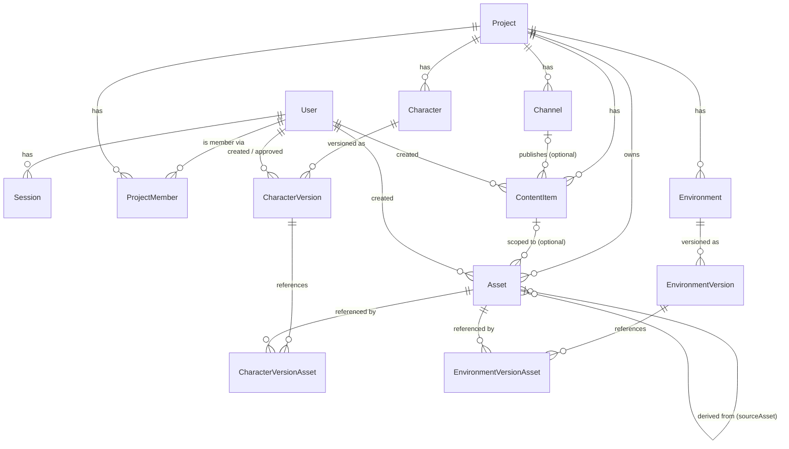

# M1 Design Proposal — Domain, Persistence, Identity & Access

- Status: **Proposed — awaiting owner approval. No M1 code has been written.**
- Date: 2026-11-17
- Inputs: `CLAUDE.md`, `docs/DATABASE.md`, `docs/API_SPEC.md`, `docs/PRD.md`, ADR-0001…0009,
  and the owner's M0 review (2026-11-17)

## 1. Scope

In scope:

- Identity and access: users, login/logout, PostgreSQL sessions, password hashing, project RBAC.
- Core domain: projects, members, channels, characters and versions, environments and versions,
  asset metadata and relations, content items.
- Database: the complete M1 Prisma schema, foreign keys, indexes, migration, seed data, audit
  timestamps, immutability of approved versions.
- API foundation: request validation, OpenAPI generation, error handling, pagination, guards,
  integration tests.

Out of scope (later milestones): AI providers, image/video/TTS generation, FFmpeg, workers,
object-storage uploads (M4), scripts/storyboards/scenes (M3), generation jobs and usage (M2/M5).

## 2. Entity-relationship diagram

### Tables and key columns

All IDs are UUIDv7 (`@default(uuid(7)) @db.Uuid`): time-ordered, index-friendly, opaque.
Timestamps are `timestamptz(3)` in UTC. Every table has `createdAt`; mutable tables have
`updatedAt`. Enum values are stored in `snake_case`.

| Table                                                                  | Key columns                                                                                                                                                                                                                                                                                                                                                                                  | Constraints / indexes                                                                                                                                                         |
| ---------------------------------------------------------------------- | -------------------------------------------------------------------------------------------------------------------------------------------------------------------------------------------------------------------------------------------------------------------------------------------------------------------------------------------------------------------------------------------- | ----------------------------------------------------------------------------------------------------------------------------------------------------------------------------- |
| `users`                                                                | `email` (normalized lowercase), `displayName`, `passwordHash`, `status` (`active`/`disabled`), `lastLoginAt`                                                                                                                                                                                                                                                                                 | `UNIQUE(email)`                                                                                                                                                               |
| `sessions`                                                             | `sid` (PK, from express-session), `userId`, `data` (jsonb), `expiresAt`, `absoluteExpiresAt`, `createdAt`, `lastSeenAt`                                                                                                                                                                                                                                                                      | FK user `ON DELETE CASCADE`; `INDEX(userId)`, `INDEX(expiresAt)`                                                                                                              |
| `projects`                                                             | `name`, `slug`, `description`, `defaultLanguage`, `timezone` (IANA), `status` (`active`/`archived`), `createdById`                                                                                                                                                                                                                                                                           | `UNIQUE(slug)`                                                                                                                                                                |
| `project_members`                                                      | `projectId`, `userId`, `role` (`owner`/`editor`/`viewer`), `addedById`                                                                                                                                                                                                                                                                                                                       | PK `(projectId, userId)`; `INDEX(userId)`                                                                                                                                     |
| `channels`                                                             | `projectId`, `name`, `slug`, `platform` (`tiktok`/`instagram_reels`/`youtube_shorts`/`other`), `handle?`, `archivedAt?`                                                                                                                                                                                                                                                                      | `UNIQUE(projectId, slug)`                                                                                                                                                     |
| `characters`                                                           | `projectId`, `name`, `slug`, `description`, `archivedAt?`                                                                                                                                                                                                                                                                                                                                    | `UNIQUE(projectId, slug)`                                                                                                                                                     |
| `character_versions`                                                   | `characterId`, `version` (int), `status` (`draft`/`approved`), `description`, `identityRules` (jsonb), `createdById`, `approvedById?`, `approvedAt?`, `basedOnVersionId?`                                                                                                                                                                                                                    | `UNIQUE(characterId, version)`; `CHECK` (approved ⇔ approvedAt/approvedById set); immutability trigger (§3.2)                                                                 |
| `character_version_assets`                                             | `characterVersionId`, `assetId`, `role` (`master`/`reference`), `sortOrder`                                                                                                                                                                                                                                                                                                                  | PK `(characterVersionId, assetId)`; `INDEX(assetId)`; partial `UNIQUE(characterVersionId) WHERE role='master'`                                                                |
| `environments` / `environment_versions` / `environment_version_assets` | Same shape as characters (`visualRules` jsonb instead of `identityRules`)                                                                                                                                                                                                                                                                                                                    | Same constraints                                                                                                                                                              |
| `assets`                                                               | `projectId`, `contentItemId?`, `assetType` (`reference`/`image`/`video`/`audio`/`subtitle`/`render`), `sourceType` (`upload`/`import`/`generated`/`derived`), `sourceAssetId?`, `sourceNote?`, `storageKey`, `mimeType`, `sizeBytes` (bigint), `checksumSha256`, `width?`, `height?`, `durationMs?`, `originalFilename?`, `metadata` (jsonb), `approvalStatus`, `createdById`, `archivedAt?` | `UNIQUE(storageKey)`; `INDEX(projectId, createdAt)`, `INDEX(contentItemId)`, `INDEX(sourceAssetId)`; `CHECK(sizeBytes >= 0)`; immutability trigger on binary-identity columns |
| `content_items`                                                        | `projectId`, `channelId?`, `title`, `status` (`ContentStatus` from DATABASE.md §4), `format` (`short_video`), `targetDurationSeconds`, `aspectRatio` (`9:16`/`16:9`/`1:1`), `language`, `brief` (jsonb, Zod-validated), `createdById`, `archivedAt?`                                                                                                                                         | `INDEX(projectId, createdAt)`, `INDEX(channelId)`; `CHECK(targetDurationSeconds BETWEEN 1 AND 600)`                                                                           |

Deferred columns, added by later migrations when their tables exist:
`assets.sceneId` (M3), and `assets.generationJobId` / `providerId` / `modelId` /
`promptSnapshot` (M2/M4). Until then, `sourceType` and `sourceAssetId` provide provenance.

## 3. Domain rules

### 3.1 Ownership

- Characters, environments, channels, assets and content items each belong to exactly one project
  (non-null FK).
- A version can only reference assets from the same project, and a content item can only use a
  channel from the same project. The service checks this inside the same transaction that writes
  the link; Postgres cannot express a cross-table project check without triggers. Integration
  tests cover it.

### 3.2 Versioning and immutability

- A version starts as `draft`. Drafts may be edited, including their asset references.
- `POST …/versions/:id/approve` (editor or owner) sets `status=approved`, `approvedAt` and
  `approvedById`. **Approved versions are immutable.** Their content columns, approval metadata and
  asset links can never change, and they can never be deleted.
- **Master** means the approved version with the highest `version` number (see decision D1).
  Approval is append-only, so a master is never overwritten. To roll back, create a new draft
  `basedOnVersionId` an older version and approve it. Old versions keep their IDs, so historical
  references stay valid.
- Defense in depth:
  1. Service-layer checks return `409 VERSION_IMMUTABLE`.
  2. A PostgreSQL trigger in the migration rejects `UPDATE`/`DELETE` on approved
     `character_versions`/`environment_versions` rows, and `INSERT`/`UPDATE`/`DELETE` on their asset
     link rows.
- Version numbers are allocated per parent inside a transaction (`max(version)+1`), protected by the
  unique constraint plus a bounded retry on conflict.

### 3.3 Assets

- Asset rows are metadata only in M1. Bytes arrive with object storage in M4.
- `storageKey`, `mimeType`, `sizeBytes`, `checksumSha256` and `sourceType` are immutable after
  insert (service check plus trigger). A changed binary is a **new** asset with `sourceAssetId`
  pointing at its origin.
- Every asset records `projectId` (ownership), `createdById` (actor) and `sourceType`, plus
  `sourceAssetId` or `sourceNote` (provenance).
- An asset referenced by an approved version cannot be archived.

### 3.4 Archive instead of delete

Projects, channels, characters, environments, assets and content items are **archived**
(`archivedAt` / `status`), never hard-deleted through the API. List endpoints hide archived rows by
default (`?includeArchived=true` shows them). This keeps lineage intact for later milestones.

## 4. Authentication and session design

| Concern            | Choice                                                                                                                                                      | Notes                                                                                                                                                                                  |
| ------------------ | ----------------------------------------------------------------------------------------------------------------------------------------------------------- | -------------------------------------------------------------------------------------------------------------------------------------------------------------------------------------- |
| Session middleware | **`express-session` 1.19.0** (expressjs org)                                                                                                                | Handles session-ID generation (`uid-safe`), cookie signing (`cookie-signature`), regeneration and destroy. Nest 12 uses Express 5.3.                                                   |
| Session store      | Thin **Prisma-backed `Store` class** over `sessions` (get/set/touch/destroy)                                                                                | Persistence only, no crypto. It gives a real `userId` FK (cascade on delete), a `revokeAllForUser` query and absolute expiry. Alternative: `connect-pg-simple` (decision D2).          |
| Password hashing   | **`argon2` 0.45.2** (node-argon2, Argon2id)                                                                                                                 | Library defaults (m=64 MiB, t=3, p=4) meet OWASP minimums. Hashes are PHC strings, so parameters can change without breaking stored hashes; rehash on login if the parameters changed. |
| CSRF               | **`csrf-csrf` 4.1.0** (signed double-submit, bound to the session ID), plus an **Origin / `Sec-Fetch-Site` check** on every non-GET request including login | `GET /auth/csrf` issues the token; clients send `x-csrf-token`. The Origin check covers login CSRF, where no session exists yet.                                                       |
| Rate limiting      | **`@nestjs/throttler` 6.x** on `POST /auth/login` (per IP and per email)                                                                                    | In-memory, so single instance; Redis storage when scaled.                                                                                                                              |
| Security headers   | **`helmet` 8.3.0**                                                                                                                                          |                                                                                                                                                                                        |

Cookie: `__Host-acf_sid` in production (requires `Secure`, `Path=/`, no `Domain`), `acf_sid` in
development, `HttpOnly`, `SameSite=Lax`. `Secure` follows `SESSION_COOKIE_SECURE`, which defaults to
true when `NODE_ENV=production` and must be explicitly false in development.
`SESSION_SECRET` (≥ 32 chars) is required. A comma-separated list lets you rotate secrets.

Lifecycle:

1. **Login**: validate input, find the user by normalized email, then `argon2.verify`. Unknown
   emails are verified against a fixed dummy hash to keep timing uniform. On success, call
   `session.regenerate()` (prevents session fixation) and store `{ userId }`. The store sets an
   absolute expiry. Response: the user profile. All failures return a generic
   `401 INVALID_CREDENTIALS`.
2. **Each request**: the store loads the session (expired or past absolute expiry means none),
   then a guard loads the user. A `disabled` user is rejected and all their sessions are deleted.
   The session is rolling: idle timeout refreshes on activity, but the absolute lifetime is fixed.
3. **Logout**: `session.destroy()` deletes the row immediately, and the cookie is cleared. This
   is the immediate revocation requirement.
4. **Admin and CLI actions** (disable user, reset password) delete all of that user's sessions.

Defaults (decision D5): idle timeout 24 h, absolute lifetime 7 days.

**Browser topology** (decision D3): Next.js acts as a same-origin proxy. The browser calls only
the web origin, and `next.config.ts` rewrites `/api/v1/*` to the API. Cookies stay first-party, so
no CORS credentials are needed. Server components forward the incoming `cookie` header when
calling the API. M1 is API-first; the web UI is limited by decision D4.

**User provisioning** (decision D6): there is no public sign-up. A CLI command creates users
(`pnpm user:create --email … --name …`, prompting for the password). Seed data creates
development users.

## 5. RBAC

Roles come from `project_members.role`. Authorization runs in two layers:

1. `SessionAuthGuard` (global, opt-out via `@Public()`) requires an authenticated, active user.
2. **Service layer**: every domain service method takes an `Actor` and calls
   `ProjectAccess.require(actor, projectId, minimumRole)`. This is the enforcement point, so it
   also protects future non-HTTP callers such as workers. For routes addressed by child IDs
   (e.g. `/characters/:id`), the service loads the row, derives `projectId`, then checks access.
   No frontend-only checks.
3. Non-members get **404**, not 403, so project existence doesn't leak (decision D7). Members
   whose role is too low get **403 FORBIDDEN**.

| Action                                                                                  |     viewer      | editor | owner |
| --------------------------------------------------------------------------------------- | :-------------: | :----: | :---: |
| Read the project and everything in it                                                   |        ✓        |   ✓    |   ✓   |
| Create/update/archive channels, characters, environments, content items, asset metadata |                 |   ✓    |   ✓   |
| Create/edit draft versions; approve versions                                            |                 |   ✓    |   ✓   |
| Update/archive the project; manage members and roles                                    |                 |        |   ✓   |
| Create a project (creator becomes owner)                                                | any active user |        |       |

Invariant: a project always has at least one owner. Removing or demoting the last owner returns
`409 LAST_OWNER`.

## 6. API surface (base `/api/v1`)

- **Auth**: `POST /auth/login`, `POST /auth/logout`, `GET /auth/me`, `GET /auth/csrf`
- **Projects**: `POST /projects`, `GET /projects`, `GET /projects/:projectId`,
  `PATCH /projects/:projectId`, `POST /projects/:projectId/archive`
- **Members**: `GET /projects/:projectId/members`, `POST /projects/:projectId/members` (by email),
  `PATCH /projects/:projectId/members/:userId`, `DELETE /projects/:projectId/members/:userId`
- **Channels**: `POST|GET /projects/:projectId/channels`, `GET|PATCH /channels/:channelId`,
  `POST /channels/:channelId/archive`
- **Characters**: `POST|GET /projects/:projectId/characters`, `GET|PATCH /characters/:characterId`,
  `POST /characters/:characterId/archive`, `POST|GET /characters/:characterId/versions`,
  `GET|PATCH /character-versions/:versionId` (PATCH for drafts only),
  `PUT /character-versions/:versionId/assets` (drafts only), `POST /character-versions/:versionId/approve`
- **Environments**: the same shape as characters
- **Assets**: `POST|GET /projects/:projectId/assets` (metadata registration; see D8),
  `GET /assets/:assetId`, `PATCH /assets/:assetId` (mutable fields only), `POST /assets/:assetId/archive`
- **Content**: `POST|GET /projects/:projectId/content`, `GET|PATCH /content/:contentId`,
  `POST /content/:contentId/archive`
- **OpenAPI**: `GET /api/v1/openapi.json`

Conventions:

- **Validation**: Zod schemas in `packages/contracts`, applied by a small `ZodValidationPipe`.
  Unknown keys are rejected (`strictObject`). Failures return `400 VALIDATION_FAILED` with
  `details: [{ path, message }]`, an additive extension of the error envelope.
- **OpenAPI 3.1**: generated from the same Zod schemas with **`zod-openapi` 6.0.2**. `nestjs-zod`
  was rejected because it declares only NestJS ≤ 11. A test asserts every registered route
  appears in the document.
- **Pagination**: cursor-based on `(createdAt, id)`. `?limit` defaults to 20 (max 100),
  `?cursor` is opaque (base64url JSON). Response:
  `{ "data": [...], "page": { "nextCursor": "…" | null, "limit": 20 } }`.
- **Concurrency**: `PATCH` endpoints accept an optional `If-Match: <updatedAt>`, and a mismatch
  returns `412`. Proposed as optional in M1 (decision D9).
- **Errors**: unique violations map to `409 CONFLICT` with a stable code (e.g. `SLUG_TAKEN`).
  Prisma error codes are never exposed.

## 7. Code organization (no premature abstraction)

- `apps/api/src/modules/{auth,users,projects,channels,characters,environments,assets,content}`:
  each has a controller (thin), a service (domain rules, transactions) and a `*.policy.ts` (pure
  functions such as `canApprove` or the version state machine, unit-tested).
- Services use `PrismaService` directly. There is no generic repository layer, since Prisma
  already is one. A shared versioning helper is extracted only if the character and environment
  code is actually identical once written.
- `packages/contracts`: request/response schemas, enums, pagination and error types, shared with
  the web app.
- `packages/database`: schema, migrations, seed, client factory.

## 8. Unresolved decisions (owner input requested)

| #   | Decision                        | Recommendation                                                                                                                                 | Alternative                                                                                                                 |
| --- | ------------------------------- | ---------------------------------------------------------------------------------------------------------------------------------------------- | --------------------------------------------------------------------------------------------------------------------------- |
| D1  | How "master" is defined         | **Latest approved version** is the master (append-only, nothing to overwrite)                                                                  | Explicit `masterVersionId` pointer on the character/environment; switching it would be audited                              |
| D2  | Session store                   | **Thin Prisma-backed store** (FK to user, revoke-all, absolute expiry)                                                                         | `connect-pg-simple` 10.0.0 (off the shelf, last release 2024-09; JSON blob with no user FK; table created in our migration) |
| D3  | Browser → API topology          | **Next.js same-origin proxy** (rewrites)                                                                                                       | Browser calls the API origin directly with CORS credentials                                                                 |
| D4  | Web UI in M1                    | **Minimal**: login page, project list, logout, to exercise the cookie/CSRF flow end to end                                                     | API only; UI deferred                                                                                                       |
| D5  | Session timeouts                | **24 h idle / 7 d absolute**                                                                                                                   | Shorter, e.g. 8 h / 24 h                                                                                                    |
| D6  | User provisioning               | **CLI + seed only**, no registration endpoint                                                                                                  | Owner-invited sign-up                                                                                                       |
| D7  | Non-member access response      | **404**                                                                                                                                        | 403                                                                                                                         |
| D8  | Asset creation in M1            | **Metadata registration endpoint** (caller supplies `storageKey`/checksum/size; no bytes) so versions can reference assets; uploads come in M4 | Assets created by seed only until M4                                                                                        |
| D9  | Optimistic concurrency on PATCH | **Optional `If-Match`** now                                                                                                                    | Mandatory, or defer                                                                                                         |
| D10 | Accessibility lint              | Adopt **`eslint-plugin-jsx-a11y-x` 0.2.0** for web (see ADR-0007 update)                                                                       | Wait for upstream ESLint 10 support                                                                                         |
| D11 | Draft version editing           | **Drafts are mutable; approval freezes them**                                                                                                  | Every edit creates a new version                                                                                            |
| D12 | Project slug uniqueness         | **Global** (single-tenant MVP)                                                                                                                 | Per creator/organization                                                                                                    |

## 9. Implementation plan (incremental; each step ends green)

1. **Schema and migration**: Prisma models (§2), the initial migration with CHECK constraints,
   partial unique indexes and immutability triggers (raw SQL in the migration), plus migration
   tests on an empty database. Integration test DB `acf_test` is managed by test setup with
   `prisma migrate deploy`.
2. **Contracts and API foundation**: Zod schemas, `ZodValidationPipe`, pagination helpers, error
   mapping (Prisma error → API code), OpenAPI document and endpoint, helmet.
3. **Identity**: the argon2 password service, the session store, `express-session` wiring,
   login/logout/me/csrf, the CSRF and Origin middleware, the throttler, `SessionAuthGuard`, the
   `user:create` CLI, and config additions (`SESSION_SECRET`, `SESSION_COOKIE_SECURE`, timeouts,
   `WEB_ORIGIN`).
4. **RBAC and projects**: `ProjectAccess`, project CRUD and archive, members (last-owner
   invariant).
5. **Channels and content items**: CRUD, archive, cross-project checks.
6. **Characters and environments with versions**: CRUD, draft/approve, asset links, immutability
   (service and trigger).
7. **Assets**: metadata registration, read/list, archive rules, lineage fields.
8. **Seed**: owner/editor/viewer dev users (password from `SEED_USER_PASSWORD`), a demo project,
   a channel, a character with an approved version, an environment, a content item.
9. **Web (if D4 is approved)**: rewrites proxy, login page, project list, logout.
10. **Docs**: `DATABASE.md` (as-built schema), `API_SPEC.md`, ADR-0009 finalized, new ADR-0010
    (versioning and immutability), `LOCAL_DEVELOPMENT.md`.

## 10. Test plan

- **Unit**: policies (role matrix, version state machine), pagination cursor encode/decode,
  error mapping, env schema additions, the password service (with fast argon2 test parameters).
- **Integration** (real PostgreSQL and Redis): the migration applies to an empty DB; triggers
  reject approved-version mutation even with direct SQL; the full auth flow (login, me, CSRF
  required, logout, then the same cookie gives 401); session fixation (ID changes on login);
  disabled user; the RBAC matrix per endpoint (viewer/editor/owner/non-member); cross-project
  reference rejection; pagination stability; archive filtering; the last-owner invariant;
  OpenAPI covers all routes.
- **E2E (web, if D4)**: Playwright login → project list → logout against a mocked or test API.
- No paid or external calls.

## 11. Risks

- The Prisma-backed session store is our code (persistence only). It gets dedicated contract
  tests against express-session's Store semantics.
- Rate limiting is in-memory, so it isn't shared across API instances. Acceptable for the single
  instance pilot.
- `zod-openapi` gives less automatic coverage than `@nestjs/swagger` decorators. A route-coverage
  test guards against drift.
- Version-number allocation under concurrent creation relies on the unique constraint plus retry.
