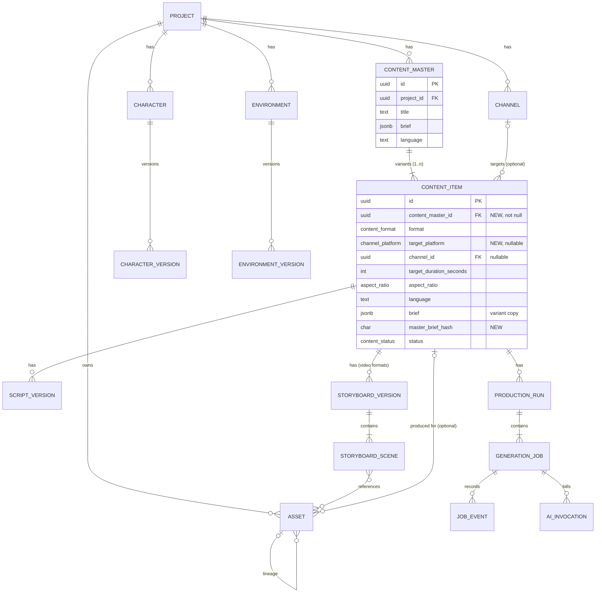

# M3.5 — Multi-format Architecture Design Review

- Status: **Approved by the owner (2026-11-18)**, all recommendations as proposed (§8). Design
  only: no code, schema, contract, API or migration change accompanies this document.
- Date: 2026-11-18
- Baseline: M3 approved (`9f2d6db`), schema migrations `init_m1`, `m2_ai_registry`,
  `m3_script_storyboard`
- Scope: how the platform grows from one format (vertical short video) to several, without
  breaking M1–M3 and without slowing M4.

## 0. Summary

The current `content_items` row already behaves like a **variant**: one format, one optional
channel, one duration, one aspect ratio, one language, with its own scripts, storyboards, jobs and
approval pointers. What is missing is the **parent** that several variants share (the idea, the
brief, the sources, the recurring character), and a place to describe formats and platforms as
data rather than as `if (format === 'short_video')`.

The proposal is deliberately small:

1. Add one table, `content_masters`, as the parent. Keep `content_items` as the variant — same
   table, same IDs, same `/content/:contentId` API. Every existing item gets its own master in a
   1:1 backfill.
2. Describe formats and platforms in code registries inside `packages/content-domain`
   (`FormatDefinition`, `PlatformProfile`, a compatibility matrix), keyed by the enums that
   already exist.
3. Describe each format's pipeline as an ordered list of stages over the **existing** job,
   version and approval machinery. Only the stage implementations are format-specific.
4. Build nothing for a second format now. M4–M6 stay video-only, but are designed against the
   variant and stage conventions so a second format later is additive.

## 1. Current architecture assessment

### 1.1 What exists after M3

```text
projects ─┬─ channels (platform enum: tiktok | instagram_reels | youtube_shorts | other)
          ├─ characters ─ character_versions ─ assets      (master pointer, approval, AC0xx)
          ├─ environments ─ environment_versions ─ assets
          ├─ assets (project-scoped, lineage, metadata only; bytes arrive in M4)
          └─ content_items (format = short_video, duration, aspect, language, brief JSON,
               │            status, approved_script/storyboard pointers)
               ├─ script_versions        (immutable, JSON content, schema_version)
               ├─ storyboard_versions ─ storyboard_scenes ─ storyboard_scene_assets
               ├─ production_runs ─ generation_jobs ─ job_events
               └─ ai_invocations (cost ledger, linked to jobs)
```

Process view: `apps/api` (NestJS) persists intent and enqueues; `apps/worker` consumes BullMQ,
calls `ai-runtime`, validates with `content-domain`, writes versions; `apps/web` drives the
review gates.

### 1.2 Strengths to keep

| Area                    | Why it already suits multi-format                                                                                   |
| ----------------------- | ------------------------------------------------------------------------------------------------------------------- |
| Job infrastructure      | `generation_jobs` + `job_events` + outbox reconciler + DLQ are format-agnostic: a job is a kind, an input, a result |
| Versioning and approval | Immutable versions, one-time review, pointer on the parent (AC012/AC013) is a reusable pattern for any artifact     |
| Execution key           | `sha256(kind, item, brief, inputs, template, model)` already dedupes any stage                                      |
| AI core                 | Capability-specific providers and a registry; routing is per task (`ai_task_routes`)                                |
| Assets                  | Project-scoped with lineage, so an image made for one variant can be reused by another without copying              |
| Brand references        | Characters/environments are project-level and versioned: naturally shared across variants                           |
| Script storage          | `script_versions.content` is JSON with `schema_version`: a different script shape per format needs no new table     |

### 1.3 Where the code assumes one format

| Coupling                                                                                           | Location                                        | Severity                                                            |
| -------------------------------------------------------------------------------------------------- | ----------------------------------------------- | ------------------------------------------------------------------- |
| The brief (shared idea) and the delivery spec (format, duration, aspect, language) live in one row | `content_items`                                 | Main gap: nothing to share across variants                          |
| `ContentFormat` enum has one value; `format` is not client-writable after creation                 | `contracts/content.ts`, schema                  | Fine; the enum grows                                                |
| Duration and aspect ratio are required columns                                                     | `content_items` (CHECK 1–600 s)                 | Blocks article/carousel formats later                               |
| Short-video duration rules hard-coded (`SHORT_VIDEO_SECONDS`)                                      | `content-domain/brief.ts`                       | Move into a format definition later                                 |
| Job input hard-codes `format: 'short_video'`                                                       | `apps/api/src/generation/generation.service.ts` | Low; read from the item later                                       |
| Prompts speak of "the video", seconds, aspect ratio                                                | `content-domain/prompts/templates.ts`           | Expected: prompts are format-specific                               |
| `ScriptContent` mixes format-agnostic plan (angle, key message, claims, sources) and video fields  | `content-domain/script.ts`                      | Acceptable now; see §4.4                                            |
| Storyboard (scenes, camera, durations) is video-only                                               | `storyboard_*` tables                           | Correct: it is a video artifact                                     |
| Content status names `storyboarding`/`storyboard_review`                                           | `ContentStatus` enum                            | Reusable as "layout planning" (§4.3)                                |
| Platform is only a label on a channel; no constraints (max duration, caption length, ratios)       | `channels.platform`                             | Gap: no platform rules anywhere                                     |
| `ai_task_routes` keyed by job kind only                                                            | schema                                          | Fine until two formats want different models for "script"           |
| One active job per (item, kind) via `active_key`                                                   | `generation_jobs`                               | Needs a scene/slot part in M4 (image per scene), not a format issue |

**Assessment:** the coupling is shallow and concentrated in `content-domain` and the shape of
`content_items`. Nothing in the job, ledger, asset or approval layers needs redesign.

## 2. Proposed architecture

### 2.1 Vocabulary

| Term                | Meaning                                                                                                                | Stored as                                            |
| ------------------- | ---------------------------------------------------------------------------------------------------------------------- | ---------------------------------------------------- |
| **Content master**  | The idea: topic, audience, objective, tone, CTA, sources, recurring character/environment. Format- and platform-free.  | `content_masters` (new)                              |
| **Content variant** | One deliverable made from a master: a format, an optional target platform/channel, a language, a delivery spec.        | `content_items` (existing; API name stays "content") |
| **Format**          | The _shape_ of the deliverable and therefore the _pipeline_: short video, image carousel, article, long video, …       | `ContentFormat` enum + `FormatDefinition` (code)     |
| **Platform**        | _Where_ it is published, and therefore its _constraints_: duration limits, aspect ratios, caption length, file limits. | `ChannelPlatform` enum + `PlatformProfile` (code)    |
| **Channel**         | A concrete account on a platform (existing).                                                                           | `channels`                                           |

Format and platform are independent axes joined by a compatibility matrix: a short video can
target TikTok, Reels or Shorts; a carousel can target Instagram or TikTok photo mode; an article
targets a website. The **format chooses the pipeline; the platform only adds validation rules
and defaults.** No pipeline code branches on platform.

### 2.2 Layering

```text
packages/content-domain/
  formats/                 NEW (when first needed)
    registry.ts            FormatDefinition per ContentFormat: spec schema, defaults,
                           pipeline stages, statuses used, artifact schemas, prompt templates
    short-video/           today's brief rules, script/storyboard schemas, prompts (moved, not changed)
  platforms/               NEW
    registry.ts            PlatformProfile per ChannelPlatform: allowed formats, aspect ratios,
                           duration range, caption/hashtag limits, file limits, source URL + date
  compatibility.ts         isCompatible(format, platform) + effective constraints (format ∩ platform)
  master.ts                master brief schema; variant creation rules; brief copy/resync
  (existing modules unchanged)
apps/api      master + variant endpoints; generation services ask the format registry which stage
              may run next instead of hard-coding it
apps/worker   one processor per stage kind (script, storyboard, image, …); the format registry
              supplies schema + prompt for that stage
```

Registries are **code, not tables**, because adding a format always needs code (schemas,
prompts, render steps) and platform rules change rarely and must be reviewed. Each
`PlatformProfile` carries `sourceUrl` and `verifiedAt` like provider facts (CLAUDE.md §6). If
operators later need to edit limits without a deploy, the profile can move to a table with the
same shape (§6, AD-3).

### 2.3 Shape of the registries (illustrative)

```typescript
interface FormatDefinition<Spec> {
  format: ContentFormat; // 'short_video'
  specSchema: z.ZodType<Spec>; // { targetDurationSeconds, aspectRatio } for video
  stages: readonly StageDefinition[]; // ordered pipeline (§4)
  statuses: ReadonlySet<ContentStatus>; // subset of the single status enum (§4.3)
  scriptSchema: { version: number; schema: z.ZodType }; // selects script_versions.content shape
}

interface StageDefinition {
  key: 'script' | 'storyboard' | 'images' | 'video' | 'audio' | 'render' | 'qc' | string;
  jobKind: GenerationJobKind; // reuses generation_jobs
  requires: readonly GateKey[]; // e.g. ['script_approved']
  produces: GateKey; // e.g. 'storyboard_approved'
  scope: 'variant' | 'unit'; // unit = scene / slide / section (scene-level retry)
}

interface PlatformProfile {
  platform: ChannelPlatform;
  formats: readonly ContentFormat[]; // compatibility matrix rows
  aspectRatios?: readonly AspectRatio[];
  durationSeconds?: { min: number; max: number };
  captionMaxChars?: number;
  hashtagsMax?: number;
  fileMaxBytes?: bigint;
  sourceUrl: string;
  verifiedAt: string; // dated facts; never assumed
}
```

## 3. Domain model and ERD

### 3.1 New and changed tables

```prisma
model ContentMaster {                     // NEW
  id            String    @id @default(uuid(7)) @db.Uuid
  projectId     String    @db.Uuid
  title         String    @db.VarChar(200)
  /// Shared brief: topic, audience, objective, tone, callToAction, notes, sourceUrls,
  /// characterId, environmentId (today's contentBriefSchema, unchanged).
  brief         Json      @db.JsonB
  /// Default language for new variants (BCP 47).
  language      String    @db.VarChar(35)
  createdById   String    @db.Uuid
  archivedAt    DateTime?
  createdAt, updatedAt
  variants      ContentItem[]
  @@unique([projectId, id])               // composite-FK target, as everywhere else
  @@index([projectId, createdAt(sort: Desc), id(sort: Desc)])
  @@map("content_masters")
}

model ContentItem {                       // EXISTING = the variant; additive columns only
  …all M1–M3 columns unchanged…
  contentMasterId   String          @db.Uuid          // NOT NULL after backfill
  /// Target platform when no channel is set; must equal channel.platform when one is (trigger).
  targetPlatform    ChannelPlatform?
  /// sha256 of the master brief the variant's brief was copied from (staleness, §3.3).
  masterBriefHash   String?         @db.Char(64)
  contentMaster     ContentMaster   @relation(fields: [projectId, contentMasterId],
                                              references: [projectId, id])
  @@index([contentMasterId])
}
```

Deferred until the first non-video format (not part of the first migration):

- `content_items.target_duration_seconds` and `aspect_ratio` become nullable, with a CHECK
  "required when `format` is a video format".
- `content_items.format_spec JSONB NOT NULL DEFAULT '{}'`, validated by the format's
  `specSchema` for format-only options (e.g. carousel slide count, article word target).
- New `ContentFormat` values (`ALTER TYPE … ADD VALUE`) and, if the format has a structured
  artifact, its own version tables (e.g. `slide_plan_versions` + `slides`) following the
  storyboard pattern (immutable, one-time review, pointer on the variant).

### 3.2 ERD (target state after the first migration)



### 3.3 Brief ownership: copy-on-create (recommended)

The master brief is the **template**; each variant keeps its **own** `brief` column, copied from
the master when the variant is created and editable per variant (e.g. a platform-specific CTA).

- M3 code reads `content_items.brief` and hashes it into the execution key: **unchanged**.
- The variant stores `master_brief_hash`. When the master brief changes, the variant shows
  "master changed" (computed, like stale storyboards) and offers an explicit **Resync from
  master**, which is an ordinary brief edit (`PATCH /content/:id`). Nothing changes silently,
  so approved scripts never become stale behind the user's back.
- Rejected alternative — master brief canonical + per-variant overrides merged at read time:
  one source of truth, but every M3 read path, the execution key and the pointer semantics
  change, and an edit to the master would silently invalidate all variants' approvals.

### 3.4 Integrity rules (ADR-0011 style, for the first migration)

| Rule                                                                     | Mechanism                                                                           |
| ------------------------------------------------------------------------ | ----------------------------------------------------------------------------------- |
| A variant's master is in the same project                                | composite FK `(project_id, content_master_id)`                                      |
| A variant's master never changes                                         | trigger (immutable identity column), `AC012`-style code                             |
| `target_platform` equals `channels.platform` when `channel_id` is set    | trigger (new SQLSTATE `AC014`)                                                      |
| Format × platform compatibility                                          | **API/domain only** (registry is code, not data)                                    |
| Masters are never hard-deleted; archiving requires all variants archived | existing `acf_forbid_hard_delete` + service rule (`409 MASTER_HAS_ACTIVE_VARIANTS`) |

Locking: creating a variant takes no lock on the master (no counter to allocate). Archiving a
master locks the master, then checks variants — parent-first order consistent with ADR-0011 §6
because no existing path locks a variant and then its master.

### 3.5 What deliberately stays the same

- `production_runs`, `generation_jobs`, `script_versions`, `storyboard_*`, `ai_invocations`,
  `assets` keep pointing at `content_items`. A job always belongs to exactly one variant.
- Assets stay project-scoped. Cross-variant reuse is by reference (scene → asset) or by a
  `derived` child (crop 9:16 → 1:1), never by copying bytes. No `content_master_id` on assets.
- Channels and characters/environments are unchanged.

## 4. Pipeline design

### 4.1 Shared components (format-agnostic, already built or planned)

| Component                                                         | Status                                                          |
| ----------------------------------------------------------------- | --------------------------------------------------------------- |
| Brief validation of the shared fields                             | M3 (`brief.ts`; duration rule moves into the format spec later) |
| Job intent → BullMQ → worker, retries, DLQ, reconciler, cancel    | M3                                                              |
| Immutable versions, one-time review, approval pointers, staleness | M3 pattern                                                      |
| Execution key + reuse of succeeded work                           | M3                                                              |
| LLM routing, ledger, cost per job                                 | M2/M3                                                           |
| Prompt templates with typed variables and snapshots               | M3                                                              |
| Object storage, upload, checksum, MIME/size validation            | M4                                                              |
| Image generation per unit (scene, slide, section)                 | M4 (designed with `scope: 'unit'`)                              |
| Asset review/approval, lineage                                    | M4                                                              |
| TTS / audio import, subtitles                                     | M5                                                              |
| Media inspection (FFprobe), QC framework                          | M6                                                              |
| Budgets, circuit breakers, run resume                             | M7                                                              |

### 4.2 Format-specific pipelines

```text
short_video (MVP)   script ─▶ storyboard ─▶ images/scene ─▶ video/scene ─▶ audio ─▶ render MP4 ─▶ QC ─▶ export
image_carousel      script(slide copy) ─▶ slide plan ─▶ images/slide ─▶ compose slides (PNG/PDF) ─▶ QC ─▶ export
article             script(outline+draft) ─▶ hero/inline images (optional) ─▶ export Markdown/HTML ─▶ QC
long_video (16:9)   = short_video stages with different spec, prompts and platform rules
```

Each format declares its stages (§2.3). The API's generation service asks the registry
"which stages can run now?" from the variant's approved pointers (gates), instead of hard-coding
"storyboard needs an approved script". Job kinds grow per stage (`image_generation`,
`video_generation`, `slide_plan_generation`, …); a stage that exists in several formats reuses
the same kind and processor, with the format supplying schema and prompt.

### 4.3 Status

Keep the **single** `ContentStatus` enum. Its stages are generic enough —
`scripting`, `storyboarding` (read as "planning the visual layout": storyboard or slide plan),
`generating_assets`, `asset_review`, `rendering`, `quality_review`, `approved`, `exported`. Each
format declares the subset it uses and its transition table in `pipeline.ts` (today's table becomes
the `short_video` table). An article simply never enters `storyboarding` or `rendering`. No
per-format status enums.

### 4.4 Master-level stages (later, optional)

Today the content plan (angle, key message, hooks, claims, sources) is part of the variant's
script (M3 F3). When two variants of one master exist, generating and approving the plan once
per master saves cost and keeps the message consistent. The roadmap adds a `master_plan`
artifact on `content_masters` (same version/approval pattern) that variant script prompts take
as input. Until then each variant plans independently; this costs one extra cheap LLM call per
variant and needs no schema now.

### 4.5 Fan-out

"Create variants" is synchronous and cheap (rows only). "Generate all variants" creates one
production run **per variant**; runs are independent, so one failing format does not block
another. No master-level run is needed before §4.4 exists.

## 5. Migration and backward compatibility

### 5.1 Migration `m35_content_masters` (one migration, additive)

1. `CREATE TABLE content_masters` (+ composite unique, indexes, no-delete trigger).
2. `ALTER TABLE content_items ADD content_master_id uuid NULL, target_platform channel_platform NULL,
master_brief_hash char(64) NULL`.
3. Backfill in the same transaction: for each content item, insert one master with
   `project_id, title, brief, language, created_by_id, archived_at, created_at` copied from the
   item; set `content_master_id`, `master_brief_hash` (computed by the same canonical-JSON
   sha256 as `content-domain`, done in a TypeScript data step if SQL cannot reproduce it exactly)
   and `target_platform = channels.platform` where a channel is set.
4. `ALTER … SET NOT NULL`; add composite FK, triggers (§3.4), index.

PostgreSQL 17 has no `uuidv7()`: backfilled master IDs are generated by the data step with the
same UUIDv7 generator Prisma uses, so ordering by ID stays consistent. Data volume is tiny
(staging and dev seeds), so the backfill runs inside the migration transaction.

**Rollback:** drop the new columns and table (no existing column is modified or dropped).

### 5.2 Compatibility guarantees

| Surface                      | Effect                                                                                                                                                            |
| ---------------------------- | ----------------------------------------------------------------------------------------------------------------------------------------------------------------- |
| Existing rows                | Each content item gets exactly one master; all IDs, versions, pointers, jobs unchanged                                                                            |
| `POST /projects/:id/content` | Same body works: creates a master **and** its first variant in one transaction. Optional new `contentMasterId` attaches the variant to an existing master instead |
| `/content/:contentId/**`     | Unchanged paths and semantics; `contentId` is the variant ID. Responses gain `contentMasterId`, `targetPlatform`, `masterBriefStale` (additive fields)            |
| M3 scripts/storyboards/jobs  | No code path changes; execution keys unchanged (brief stays on the variant)                                                                                       |
| DB guards AC011–AC013        | Untouched; new rules use new trigger/codes                                                                                                                        |
| Tests                        | All M1–M3 suites must pass unchanged; new tests cover backfill, FK/trigger rules, new endpoints, permission matrix rows                                           |
| Web UI                       | Unchanged pages keep working; a master page listing variants is additive                                                                                          |

### 5.3 New endpoints (additive, for the implementation slice)

| Endpoint                                    | Viewer | Editor/Owner | Notes                                                                                           |
| ------------------------------------------- | :----: | :----------: | ----------------------------------------------------------------------------------------------- |
| `POST /projects/:projectId/content-masters` |  403   |     201      | Master only, no variant                                                                         |
| `GET /projects/:projectId/content-masters`  |   ✓    |      ✓       | Paginated; variant count and statuses                                                           |
| `GET /content-masters/:masterId`            |   ✓    |      ✓       | With variants                                                                                   |
| `PATCH /content-masters/:masterId`          |  403   |      ✓       | Title, brief, language; `If-Match`; variants become "master changed"                            |
| `POST /content-masters/:masterId/variants`  |  403   |     201      | `{ format, channelId?, targetPlatform?, language?, spec }`; compatibility checked; brief copied |
| `POST /content/:contentId/brief/resync`     |  403   |      ✓       | Copy master brief into the variant (a normal brief edit)                                        |
| `POST /content-masters/:masterId/archive`   |  403   |      ✓       | `409 MASTER_HAS_ACTIVE_VARIANTS`                                                                |

New error codes: `FORMAT_PLATFORM_INCOMPATIBLE` (422), `MASTER_HAS_ACTIVE_VARIANTS` (409),
`PLATFORM_CHANNEL_MISMATCH` (422, mapped from `AC014`).

## 6. Architecture decisions and trade-offs

| ID    | Decision (recommended)                                                                                                                  | Alternative                                             | Why                                                                                                                  |
| ----- | --------------------------------------------------------------------------------------------------------------------------------------- | ------------------------------------------------------- | -------------------------------------------------------------------------------------------------------------------- |
| AD-1  | New `content_masters`; **`content_items` is the variant**, table and API name unchanged                                                 | Rename to `content_variants` / new table and move FKs   | Zero churn in M1–M3 code, FKs, triggers, tests and URLs; "variant" is a documentation term                           |
| AD-2  | Brief **copied** into the variant at creation; explicit resync with staleness hash                                                      | Master canonical + merged overrides                     | Keeps M3 execution keys and approvals stable; no silent invalidation                                                 |
| AD-3  | Formats and platform profiles are **code registries** keyed by existing enums                                                           | Lookup tables editable at runtime                       | A new format needs code anyway; platform limits change rarely and need review. Revisit if operators must edit limits |
| AD-4  | Format chooses the pipeline; platform only adds constraints/defaults; compatibility matrix in code                                      | Pipelines per (format, platform)                        | Avoids N×M pipelines; TikTok vs Reels differ in limits, not in steps                                                 |
| AD-5  | Single `ContentStatus` enum; each format uses a subset with its own transition table                                                    | Per-format status enums or a free-text stage column     | No migration; UI and filters stay uniform                                                                            |
| AD-6  | Reuse `generation_jobs`; add job kinds per stage; stage descriptors declare gates and scope (`variant`/`unit`)                          | Format-specific job tables                              | One worker, one ledger, one reconciler                                                                               |
| AD-7  | Script stays one table (schema chosen by the variant's format + `schema_version`); structured artifacts get their own tables per format | Generic `artifact_versions(kind, jsonb)` for everything | Scenes/slides need row-level FKs (assets, characters) and scene-level retry; a generic EAV loses them                |
| AD-8  | Duration/aspect columns stay required until the first non-video format; then nullable + CHECK + `format_spec`                           | Move everything into `format_spec` now                  | No change to working M1–M3 validation now                                                                            |
| AD-9  | Assets stay project-scoped; reuse across variants by reference or derived child                                                         | Master-scoped assets                                    | Lineage already covers it; no new FK                                                                                 |
| AD-10 | Content plan stays in the variant script until a master-plan stage is justified by real multi-variant use                               | Master plan stage now                                   | Avoids changing the approved M3 script schema and gates                                                              |

Risks:

| Risk                                                     | Mitigation                                                                                      |
| -------------------------------------------------------- | ----------------------------------------------------------------------------------------------- |
| Brief copies drift from the master                       | Visible "master changed" flag; resync is one action; drift is intentional per-platform tuning   |
| Platform facts (max duration, ratios) go stale           | `sourceUrl` + `verifiedAt` on each profile; re-verify before publishing features (FR-017)       |
| `storyboarding` status name reads oddly for carousels    | UI labels come from the format definition; the stored value stays                               |
| Two formats wanting different models for "script"        | Extend `ai_task_routes` key to `(task, format)` with `format` nullable as fallback, when needed |
| Backfill hash must match `content-domain` canonical JSON | Data step uses the same function; a test asserts equality on fixtures                           |

## 7. Implementation roadmap

| Step   | When                                           | Scope                                                                                                                                                                                                                                                   | Size                                  |
| ------ | ---------------------------------------------- | ------------------------------------------------------------------------------------------------------------------------------------------------------------------------------------------------------------------------------------------------------- | ------------------------------------- |
| **R0** | Before M4 (recommended) or as M4's first slice | Migration `m35_content_masters` + backfill; `PlatformProfile` registry for the 3 existing platforms (verified facts); compatibility check on create; master endpoints (§5.3); `contentMasterId` in content responses; tests. No change to M3 generation | 1 slice                               |
| **R1** | During M4–M6                                   | Build image/video/audio/render as `short_video` stages with `scope: 'unit'` (scene); stage descriptors in `content-domain/formats/short-video`; generation service reads gates from the descriptor. Still one format                                    | Inside each milestone, no extra slice |
| R2     | After MVP acceptance                           | First second format — recommended **image_carousel** (reuses M4 images, needs no video/audio, cheap): enum value, nullable duration/aspect + `format_spec`, slide-plan artifact, compose step, QC                                                       | 1 milestone                           |
| R3     | After R2                                       | Master plan stage (§4.4), "generate all variants" fan-out, `(task, format)` routes if benchmarks justify                                                                                                                                                | 1 milestone                           |
| R4     | Later                                          | `article`, `long_video`; localization variants (language as a variant dimension already works); direct publishing per platform (FR-017, P2)                                                                                                             | per format                            |

**MVP scope recommendation:** R0 + R1 only. The MVP remains vertical short video (PRD), but
every M4+ table and job is variant-scoped and stage-described, so R2 is additive.

## 8. Owner decisions (2026-11-18)

All recommendations approved as proposed:

| ID       | Question                                       | Decision                                                                                         |
| -------- | ---------------------------------------------- | ------------------------------------------------------------------------------------------------ |
| AD-1     | Data model                                     | New `content_masters` parent; `content_items` stays the variant (no rename, same API)            |
| AD-2     | Brief ownership                                | Copy-on-create into the variant; "master changed" flag and explicit resync                       |
| AD-3/4   | Format and platform management                 | Code registries in `content-domain`; format chooses the pipeline, platform adds constraints only |
| R0       | Timing                                         | Standalone slice **before M4**                                                                   |
| R2       | First format after the MVP                     | Image carousel                                                                                   |
| Platform | Variant targeting a platform without a channel | Nullable `target_platform`, derived from and checked against the channel when one is set         |

Next: R0 is planned and implemented as its own slice (with an ADR recording AD-1 to AD-4), then
the M4 design package is written on top of it.
